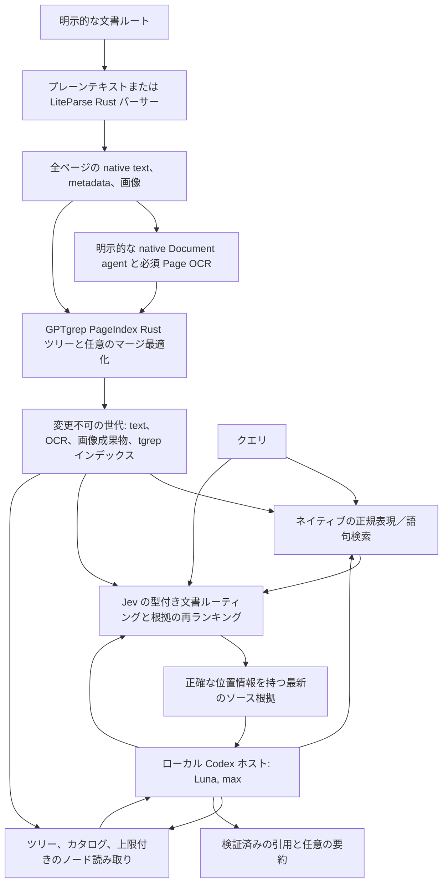

# GPTgrep アーキテクチャ

[English](architecture.md) | [简体中文](architecture.zh-CN.md) | [日本語](architecture.ja.md)

GPTgrep は、推論を行うエージェントがローカル文書へ高速にアクセスし、その根拠を確認できるように
します。厳密な検索、確率的な判断、モデルによる回答の生成を、それぞれ独立した操作として扱い、
別々の実行記録を残します。
デフォルトの検索とローカル推論ホストでは、Jev のルーティングと再ランキングを必須とします。
厳密検索の基本操作は、確認のために単独でも呼び出せます。



現在の実装と未完了の live gate は[実験状況](experimental-status.md)、移植可能な
ビルド・独立 Codex ログイン・native runtime・full62 の準備は[開発ガイド](development.md)を参照してください。
34 文書全体のパイプラインと 62 組の SEARCH は未受理です。INDEX は別計測で、PageIndex G5 の初回タグ条件も別です。

## モジュールの責務

| クレート／インターフェース | 責務 | 実行時の外部依存 |
| --- | --- | --- |
| `gptgrep-pageindex` | 純粋な Rust によるページ／セクション座標、見出し階層、ブックマーク統合、構造の最適化 | なし |
| `gptgrep-parse` | 文書全体のバッチ処理、UTF-8／native metadata、画像準備、OCR 統合、成果物の来歴 | ネイティブ文書には PDFium、Office 変換には LibreOffice |
| `gptgrep-index` | tgrep-core の組み込み、安全側に候補を残すトライグラム検索、Rust 正規表現による厳密な検証 | なし。デーモン不要 |
| `gptgrep-jev` | Choice/Noul/Score Decisions の通信、スキーマ検証、上限付きの推論 | 明示的な OpenRouter リクエスト |
| `gptgrep-core` | 準備済み文書の toolbox、完全な rich generation 公開、ソースの鮮度、検索と根拠の契約 | デフォルトの hybrid と semantic 検索では Jev が必須 |
| `gptgrep-host` | native Page OCR と Document driver、Codex reader、ツール振り分け、最終引用検証 | 呼び出し側が選択した Codex インストールとアカウント |
| `gptgrep-cli` | ネイティブの argv、JSON、スキーマ、grep 形式の表示 | ローカルコマンドには不要 |
| `packages/cli` | 任意の incur 表示・検出ラッパー | Node と公開済みの incur 0.5.1 |

Decisions のデフォルトは `openai/gpt-6-luna-decisions` です。上限付きのフラットな
型付き PNG/JPEG 入力を扱い、返されたモデル識別子を厳密に検証します。
`typesafe/jev-1.13` は明示的に選択できるテキスト専用オプションです。明示的な
`~author/family-latest` エイリアスもテキスト専用で、同じ作者・同じファミリーの具体的な
ビルドだけを受け入れます。報告では、要求したセレクターと実際に応答したモデルを分けて保持します。
ルーティング、再ランキング、ホストの後続呼び出しは、任意の既存台帳の `ExecutionContext` を
共有します。参加しても元の時計や消費済みの割り当てはリセットされません。新しい台帳は
`gptgrep decisions-budget init` で一度だけ作成し、`status` は読み取り専用で確認します。
ネイティブ Codex のモデル選択は別に設定します。

このプロジェクトで選択されたホストプロファイルのデフォルトは、`model = "gpt-6-luna"` と
`model_reasoning_effort = "max"`、`service_tier = "fast"` です。これらはローカルヘルパーの設定であり、開発を担当する
エージェントのモデルは変更しません。実行時の `CODEX_HOME` により、既存のアカウント環境を選択
します。プログラムが認証ファイルを読み取ったりコピーしたり、グローバルプロファイルを変更したり、
対話的なログインを実行したりすることはありません。
ネイティブ OCR と document-agent の子プロセスは、Codex が管理する ChatGPT 認証と、この
アカウントホーム内のファイル認証情報ストアを明示的に選択します。承認済みのデバイスログインの
キャッシュを再利用し、実行ごとの状態、ログ、一時ファイルは分けて保持します。トークンの更新は
選択した Codex ランタイムが担います。名前付きのファイルシステム権限はソース画像をモデルの
ツールに許可し、認証情報のホームはその許可の外に置きます。起動時に旧来のサンドボックス設定と
組み合わせることはありません。任意の `--codex-state-dir` は、ネイティブの SQLite 状態用に別の
既存の正規ディレクトリを選び、ログにはその既存の `logs` 子ディレクトリを使います。認証には
引き続き `--codex-home` を使い、一時ファイルとプロトコルトレースの置き場所は呼び出し側が別に
指定します。`--codex-permissions PROFILE` は、既存の名前付き権限 profile をスレッドとターンの
両方で明示的に選択します。ホストはターンの開始前に確認済みの profile ID を必須とし、この選択では
旧来のサンドボックス上書きを省きます。ネットワークアクセスは無効のままである必要があり、
ネイティブの読み取り専用の投影か、旧来の書き込み可能ルートがなく、一時ディレクトリの除外を
両方とも有効にした workspace-write の投影を受け入れます。確認と投影の検査は選択した方針を
識別するだけで、実際のファイルシステムの拒否は実行時の検証が必要です。

アクティブなターンの失敗は、`host_protocol.diagnostics`（モデル試行のプロトコルエラー内でも
参照可能）と、対応する非公開トレースの `error_diagnostics` を保持します。OCR ランタイムのエラーも、
同じ閉じた投影を `diagnostics` に保持します。`gptgrep.codex.error-diagnostics.v1` は、型付きの
ネイティブなエラー種別、構造化されたプロバイダーエラーに由来する固定の許可リストのエラーコード／
型／パラメーター群、明示的にラベル付けしたアンカー付きのメッセージシグネチャを区別します。
観測したエラーがその根拠を含む場合、ツール定義、出力スキーマ、モデル選択、認証、通信、
サーバーの失敗を識別できます。分類は観測したエラーの根拠を表すもので、独立に検証した根本原因では
ありません。矛盾する根拠や認識できない根拠は `unknown` のままです。

この投影は、任意のエラーテキスト、ヘッダー値、URL、リクエスト本文、エラー文字列中のモデル名、
拒否されたプロパティ名を保存しません。フィールドの形とバイト長を記録し、文字列全体が 16 KiB
以下の場合にだけ SHA256 も記録します。上限を超えるフィールドは走査もハッシュ計算もしません。
許可するテキスト文法は、完全な JSON エラー、上限付きの `unexpected status` HTTP エラー
エンベロープ、固定のアンカー付きエラーシグネチャだけです。HTTP エンベロープでは、空の接尾辞か、
`, url: ` に続く空白を含まない 2,048 バイト以内の HTTP(S) URL 1 つを許可し、その後に任意で
`, request id: ` と、英字・数字・アンダースコア・ハイフンだけから成る 1〜128 文字の ASCII 識別子を
続けられます。URL 内の引用符、バックスラッシュ、JSON の波括弧、山括弧は拒否し、それ以外の接尾辞や
2 つ目の JSON 値があればエラーは不明のままです。原因の分類では、任意の部分文字列の JSON 探索や
キーワード検索を行いません。構造化された `invalid_request_error` メッセージは、固定の API
パラメーター許可リストに含まれる語を重複除去して `request_subject_hints` として報告することも
ありますが、これらのヒントは原因を確定せず、任意の語を保持することもありません。ネイティブの
再試行処理、元の期限、ツールの上限、不明な使用量の計上は変わりません。エラー内容がすでに破棄
された過去の実行について、これらの診断で原因を復元することはできません。

## ネイティブ解析と OCR

`gptgrep-core::parse_agent` は、1 回の呼び出しで登録したソースの pin、不透明な文書／成果物／タスクの
ハンドル、完全なネイティブ抽出、共有のパーサー予算を管理します。その foreground NDJSON の窓口は、
ページ単位の完全な一覧と上限付きの範囲に対応します。ハンドルを閉じると、同じソースバイトを開き直して
同じ内容に結び付いたタスクダイジェストが得られる場合でも、その切り抜きの管理は無効になります。JSON で
有料の OCR 結果を渡したり、新しいソースパスを受け入れさせたりすることはできません。
`gptgrep-host::parse_agent_driver` は、この型付きバックエンドの上で、選択した単体の Codex app-server
による文書ターンを調整します。

`parse-agent serve` は foreground NDJSON toolbox、`run` は完全な決定的解析と任意の OCR（明示的な `--mode auto`）、
`agent` は一回の native Document turn、`qualify` は profile を自動で受理せずに非公開の画像の根拠を記録します。
明示的な index registry が完全な検証済み成果物を writer に渡します。writer は再解析せず、元のパーサー／OCR の
コンテキストを共有し、ソースの pin と一覧を再検査し、完全な受け入れ判定の後にだけ公開します。
Document は標準で 64 tools／1 turn／900 秒、一致する profile では最大 3600 秒を明示できます。
実際の期限は frontend、session、元の phase の各期限の最小値です。Page OCR は独立して 8 tools／1 turn／180 秒です。
原文全ページの解析・metadata coverage と、モデルが実際に確認した範囲を分けて記録します。
ページウィンドウはバッチ上限であり、文書全体のページ数制限ではありません。論理 buffer／staging 予約は
プロセス全体の RSS や物理ディスク使用量の実測ではありません。native `view_image` は
[固定された source derivative](../patches/codex-native-viewer/README.md)を使い、実際の binary／profile を
Page と Document で別々に検証します。ビルド成功だけでは live 受理になりません。

エンコード済みのページ画像の容量は、既存の parse-agent 制御ファイルの `resources` オブジェクトで
設定します。CLI はこの制御ファイルを `--config` と `--expected-control-sha256` で読み込み、`index`
は固定した `--parse-agent-config` の制御ファイルを使います。既定値は、画像ファイル 1,048,576 バイト、
base64 1,398,104 バイト、ページあたりの画像ファイル 4,194,304 バイトです。4 MiB のページ画像を
受け入れるには、完全な制御ファイルで次の 3 つのフィールドを設定し、選択済みのその他の資源
フィールドを維持して、制御ファイルのダイジェストを再計算します。

```json
{
  "image_file_bytes": 4194304,
  "image_base64_bytes": 5592408,
  "image_file_bytes_per_page": 4194304
}
```

これらは設定可能な容量です。base64 の容量は選択したファイル容量を覆い、ファイル容量はページ
あたりの容量に収まる必要があります。実際の処理には、画素、デコード、作業メモリ、文書／実行単位の
staging の受け入れ判定が引き続き適用されます。エンコード容量を大きくしても、元の呼び出しの
サーバー側の上限を引き上げたり、共有の staging カウンターを置き換えたりすることはできません。
画素とデコードの上限は既存の既定値と上限値を維持します。文書と実行の staging 容量は呼び出し側で
設定でき、保持する成果物は元の呼び出しのカウンターを共有します。テキストのみの処理では、使わない
画像容量を予約せずに、より小さなメモリや staging の範囲を選べます。

ネイティブ Page profile は、これらの資源から `image_file_bytes`、`image_base64_bytes`、
`image_wire_bytes`、`image_transport_bytes` を個別に持つ `image_limits` を導きます。4 MiB の例では、
画像 1 枚あたりの通信上限は 5,657,944 バイト、累積の画像バイトは 5,854,568 で、後者は profile の
`image_transport_reserved_bytes` でもあります。通信上の割り当ては、上限付きの JSON 構造を base64
とは別に含みます。ネイティブ Document の制御ファイルとそのガード profile も、同じ型付きの画像ごとの
上限を持ち、制御ファイルの `image_wire_bytes` が文書全体の累積の割り当て（既定 32 MiB）を選びます。
ライブラリ関数 `document_native_image_limits` はこれをパーサーの資源予算に結び付けます。どちらの
モードも正確な上限を受け入れ判定と準備完了の根拠に記録し、ソースと準備済み画像の記録をそれに
照らして検証します。RPC フレームは別の 4 MiB 上限を維持し、画像バイトを RPC フレームとして
受け入れることはありません。

保持される固定 Page/Document モードでは、ネイティブバイナリ、profile、画像上限の組み合わせを
変えると、その組み合わせについて新たな検証が必要です。
`OcrRuntimeProfile::unqualified_native_with_resources` は Page profile を導き、既存の
`native_page_probe` の例は、2 枚の画像による検証で任意の `resources` 制御オブジェクトを受け付けます。
省略すると既定値を使います。これらの固定モードの検証は、範囲を限定したコンポーネントの根拠です。
現在の D3 の作業は、エージェントのネイティブツールと Skill による完全なネイティブ PTC の解析／OCR
であり、新たな固定 Page/Document の検証はその主線の前提条件ではありません。Decisions は独立した
画像あたり 1 MiB の契約を、HTTP `/ocr` 互換エンドポイントは独立した 1 MiB の本文画像上限を
維持します。

## 取り込みとスナップショットの整合性

文書集合のルートは明示的に指定します。通常の無視ルールは Git リポジトリ外でも適用します。
隠しエントリ、Git／実行時／ビルド用ディレクトリ、認証情報用のファイル名、秘密鍵、シンボリック
リンク経由のソースエントリは除外されます。ソースパスは文書集合の内部に収まります。
ネイティブ解析は、すべての物理ページを処理しなければなりません。依存機能の不足、抽出エラー、
OCR が無効な状態でのテキストのないスキャン文書はエラーとして扱い、空文書の処理成功とは
みなしません。空のプレーンテキストは有効な文書ですが、根拠となる範囲はありません。

書き込み側は OS のファイルロックを保持します。`.gptgrep/generations/` の下に一意の世代を
作成し、ソースのバイト列を読み取ってハッシュを計算し、解析した後、ソースのダイジェストを
再検査します。正規化テキストと型付きのソースマニフェストを書き込み、トライグラムインデックスを
構築し、完全性を検証した上で、`CURRENT.json` をアトミックに公開します。構築に失敗した場合は、
以前のポインターを維持します。古い世代は保持し、インデックス操作の一部として自動削除は行いません。

ポインターは、マニフェストのダイジェストと世代を対応付けます。マニフェストは、正規化済みの
ルートパス、文書 ID、ソース／テキストのダイジェスト、パーサーの識別情報、ページ、ノードを
対応付けます。読み取り側は、識別情報の重複、不正な範囲や階層、互換性のないスキーマを拒否します。
インデックスアダプターも独立に、ファイルテーブルと候補テキストのダイジェストを対応付けます。
これらの検査は偶発的な破損を検出するためのものです。インデックスは、未知の第三者が提供した
ものの真正性を暗号学的に保証する形式ではありません。

ヒットの `source_fresh=true` は、その取得のために検査した時点で、元ソースのバイト列が記録済みの
ダイジェストと一致したことを意味します。選択されたソースは、リモート推論の後にもう一度検査
します。ファイルシステムの全エントリを直近に再検出したことまでは意味しません。`status` は既存の
インデックス済み文書を検証し、`index` は追加されたファイルを検出して、新しい文書集合の
スナップショットを確立します。該当なしという検索結果もそのスナップショットを対象としており、
処理範囲や古い状態に関する警告と併せて解釈する必要があります。

## 検索モード

**デフォルトは Hybrid です。** 通常のワークフローでは Jev のルーティングと再ランキングを必須とし、
認証情報の不足や推論エラーを拒否します。明示的な regex と lexical は、制御されたアブレーションも
含めたローカルの基本操作です。Jev が失敗した後の代替経路ではありません。
標準の legacy 解析はローカルです。明示的な OCR と Document-agent 索引は native model を呼び、
完全でソースに結び付いた成果物だけを公開します。enrich は独立したモデル補助ナビゲーション層です。

正確な文書パスを指定すると、すべての候補上限より前に、トライグラム候補と Jev のルーティングを
絞り込みます。報告は `document_scope` を保持し、`indexed_files` は文書集合全体を、
`scoped_files` は指定された検索範囲を数えます。不明なパスや正規化されていないパスはエラーとなり、
通知なく文書集合全体の検索へ広がることはありません。

**Regex** は、tgrep の安全側に候補を残すトライグラムプランを使った後、元の正規化 UTF-8
テキストの各行に同じ正規表現を適用します。MatchAll のプランは候補を走査するものであり、
ヒットなしを意味しません。Unicode の大文字・小文字の同一視と UTF-8 BOM の扱いでは、
取りこぼしを避けるために候補を広げる必要があります。リテラルクエリはプラン生成前にエスケープ
します。文脈行数のデフォルトは grep と同じ 0 で、増やす場合は `-C` を指定します。

**Lexical** は同じインデックスでクエリのトークンに一致する箇所を探し、根拠をツリーノードごとに
まとめ、語句の網羅度で並べます。このスコアはローカルな語句検索の尺度であり、埋め込み距離や、
校正済みの意味的な確率ではありません。語句検索とハイブリッド検索で使う語は最大 16 個です。
小文字の英数字トークンを重複除去し、固定の小さな英語機能語リストと、3 文字未満の ASCII 英字
トークンを除きます（数字を含むトークンと非 ASCII のトークンは残し、除かれるトークンだけの
クエリではそれらを残します）。16 個を超える場合は、先頭 64 個を対象範囲のインデックスでの
文書頻度で並べ、まれな語を先に、範囲内に存在しない語を最後に、同順位は質問中の順序とします。
照合は検索と同じ検証済みの大文字小文字を区別しない方法です。同じスナップショットと範囲では
選択は決定的です。

**Hybrid** は語句検索の候補を保持し、別の意味的なツリー検索経路を加えます。まず Jev が、
パス、見出し、冒頭のテキストを含む、上限付きの文書説明を判断します。選択された文書のリーフ
ノードは、クエリとのトークンの重なりに依存せずに根拠を提供します。次の段階では、候補ごとの
Score 判断により、上限付きで統合した候補を並べ替えます。**Semantic** は、語句検索による
初期候補を使わずに、このツリー検索経路を使用します。初期のルーティングでは最大 32 件の文書説明を、
最終段階では最大 24 件の候補を調べます。これは開発段階で明示された処理上限であり、大規模な
文書集合全体を網羅する意味検索ではありません。coverage レポートは調査済みの範囲と打ち切りを
示します。ルーティングはスコアにかかわらず上位の文書を選ぶため、ルーティング可能な文書が
1 件だけの場合（明示的な `--document` の範囲や、鮮度の確認できた索引済み文書が 1 件だけの
場合など）は、ルーティングの Decisions 呼び出しを行わずにその文書を選びます。ツリーノード
候補と再ランキングのリクエストは変わらず、`coverage.routing_status` は `routed` ではなく
`skipped_single_document` を示します。リッチテキストの初期検索も同じ規則に従います。文書集合の階層的なルーティングと、再開可能な探索範囲の拡張は、今後の拡張課題です。

Choice のスコアは提示された選択肢どうしの比較なので、絶対的な関連性としては使いません。
再ランキングでは、同じ具体的な Score 評価基準を各候補へ独立に適用し、評価レベルの期待値を
0..1 に正規化し、任意の confidence も保持します。スコアも confidence も真実性を証明しません。
除外済みの候補を再ランキングで取り戻すことはできません。ホールドアウトデータによる評価で
裏付けられるまでは、confidence に基づく回答抑止の閾値を校正済みとは表示しません。

初期の明示的な関連性の下限は、順序付き評価基準の 0.5 であり、運用上の選択方針です。
ハイブリッドモードでは、独立したトークンへの厳密な一致を語句検索経路に残し、`literal_anchor` と
して示します。モデルのスコアは書き換えません。これにより、不確かな意味的判断によって、
検証済みの grep 一致が消されるのを防ぎます。要求された下限未満のスコアで返された結果には
`below_threshold: true` が付きます。再ランキングした候補がどれも下限に届かず、リテラル
アンカーもない場合、検索は空の結果を返さず、スコア上位 3 件をそれぞれ `below_threshold` と
して返し、`coverage.below_threshold_fallback` に件数を示し（`filtered_candidates` にも
含まれます）、低信頼度の候補であるという警告を付けます。件数と警告は、結果数の上限と最後の
鮮度確認の後に実際に返した印付きの結果だけを表します。これらが下限を満たしたとは扱わず、
ホストの初期検索は `filtered_all` を報告します。プレーンテキストの `search` は、これらを
`PATH:LINE:TEXT` の一致としてではなく、grep の文脈行の区切り（`PATH-LINE-TEXT`）で出力し、
結果を返すため終了ステータスは 0 です。証拠ロールの並べ替えも同じ代替を行います（適格性は
`below_floor_fallback`）。リッチテキスト／マルチモーダルの経路は従来の下限のままで、
この代替を行いません。回答なしのケース、リテラルクエリ、自然言語の
質問は、それぞれ別に評価します。

Decisions は `/api/alpha/decisions` を使い、リクエストの制限時間は 20 秒です。
リダイレクトとプロバイダーのフォールバックは行いません。質問数の上限は 64 です。
既定のテキスト検索クライアント（検索の文書ルーティングと証拠リランク。ask/summarize の初期検索と
読み手の検索を含む）は、HTTP 429、500、502、503、504 を受信した場合に限り、同一のリクエスト
バイトで有界の再試行を1回だけ行います。250〜1000 ms のジッター付き待機、またはそれより長い
`Retry-After`（1つの非負整数の秒数で、10桁以内）を待ち、元のリクエスト期限にその待機と 2 秒が残る
場合だけ再試行します。期限は延長しません。それ以外の形式の `Retry-After`（HTTP 日付、重複した
フィールド、負数・小数・桁数超過の値）は無視せず再試行を拒否し、その理由を失敗の診断情報の
`retry_after_refusal`（`repeated`、`out_of_range` または `not_delta_seconds`）に記録します。
再試行は同じ実行コンテキストで別の提出として予約し、残りの提出枠がなければ行いません。提出枠を
使い切った後の呼び出しは、送信前に `Decisions submission budget exhausted` として失敗します。
タイムアウト、接続や本文途中のエラー、解析・検証の失敗、その他のステータスは再試行しません。
両方の試行を報告します。失敗した試行は HTTP ステータスを `jev_retried_attempts` に残し、
`jev_calls_attempted` に数えますが使用量の項目は持たないため、不明なコストにより会計は未完了の
ままです。再試行は受け入れられた時点で試行として数えます。待機、予約、送信の前に、失敗した
試行を記録済みの `before_retry` 進捗レシートを出すため、再試行中に検索を取り消しても、どちらの
提出もホストの台帳から失われません。このレシートを記録できない場合、再試行は送信しません。
計画されたクエリビューの各操作は、論理呼び出しごとにこの再試行を1回まで受け入れ、失敗した操作の
レシートは再試行された試行を保持します。再試行の送信後に起きたエラー（ローカル台帳の記録失敗
など）は種類 `retry_post_send` となります。再試行の応答が既に検証済みなら、プロバイダーはその提出を
既知の使用量で完了しています。失敗の診断情報はその検査済みの数値使用量と応答モデルを保持し、
検索エラー、操作レシート、ホスト台帳はそれを `jev_requests`、`jev_models`、`jev_usage` に数えます。
検証前なら使用量は不明のままです。送信前に
止まった再試行だけが `retry_admission` です。judge、拡張のサポート呼び出し（独自の明示的な
再試行計画）、ナビゲーション走査、証拠ロール判定、リッチ／マルチモーダル検索、明示的な
再ランキング候補プールとバッチの提出は1回だけ送信します。リッチ経路は、呼び出し元の
クライアントに付いた再試行方針を外します。
テキストリクエストと、エスケープ後のテキスト／質問のエンベロープは 64 KiB 以内です。
型付き Luna 画像リクエストの本文全体は 8 MiB 以内で、PNG/JPEG は最大4枚です。
各画像は圧縮データが 1 MiB、画素数が800万以内、合計画素数は2400万以内です。
Base64 と JSON の構造も本文全体の上限に含めます。
応答の形式不正、欠落、重複、対応関係の不一致は明示的に失敗します。
返されたモデルと、取得できた使用量・コストを保持し、取得できない指標は null のままにします。

## 根拠とプログラムによる組み合わせ

ヒットには、ソース相対パス、ノード ID、ソースの SHA-256、物理ページ範囲、行範囲、
正規化された UTF-8 テキストの正確なバイト区間、列オフセット、打ち切りフラグ、スコア、引用、
鮮度が含まれます。プレーンテキストのバイト／行座標は元の UTF-8 ソースを参照します。
PDF／Office の座標は、正規化された抽出テキストと元文書の物理ページを参照します。
文書に印字されたページ番号を、物理ページの代わりには使いません。

長い抜粋は一致箇所を中心に範囲を制限し、先行する文脈の切り詰め方によって一致箇所が
失われないようにします。テキストのバイト区間は、CRLF と Unicode を保った内容に対応します。
コアは行オフセットを文書ごとに一度だけ事前計算し、指定された正規表現の結果件数に達すると
整形を停止するため、出力上限は表示整形にかかる処理量の上限にもなります。
ノードの読み取りは、上限を設けて続きを取得できるように、`node_offset` と `next_offset` を
提供します。返す各範囲は、正確なオフセットと長さで再検証します。ネイティブ grep の文脈が
ノード境界をまたぐ場合は、その文脈を保持し、ノードカーソルは付けません。

ネイティブ CLI が正式な grep インターフェースです。任意の incur ラッパーは、シェルの文字列展開を
介さずに型付き JSON リクエストをネイティブ argv に渡します。MCP、更新、スキル同期の
エントリーポイントは、incur の振り分け処理に入る前に拒否します。`--schema` と `--llms` は、
小さく検出しやすいプログラム向けの契約を公開します。

## PageIndex スタイルのローカル推論

ローカルホストは Codex の stdio app-server を使用し、PageIndex のクラウドアカウントや
MCP サーバーは使用しません。モデルには、上限付きの GPTgrep の根拠操作を提供します。
質問、ルート、タイムアウト、ツール呼び出しの上限、アカウントのホームは、呼び出し側が管理します。
デフォルトでは回答 worker の起動前に、初期の Jev ハイブリッド検索を実行し、上限付きで発行済みの根拠を
最初のプロンプトに渡します。ツリーや読み取りツールの選択によって、この段階を省略することはできません。
要約では、選択したノードの文書を対象にします。後続の検索もデフォルトは hybrid です。
ホストは Codex の使用量と併せて、各 Jev 検索の処理範囲と使用量を保持し、全体の制限時間には
初期検索も含めます。空の範囲や古いソースのみの範囲は、再ランキングの成功を示しません。
要約と検索には実際のソース根拠を使います。モデルが生成した引用は、その実行中に提供された
根拠へ解決でき、完了時点でも最新でなければなりません。検索の読み手への指示（制限付きと
ネイティブの両方）には、汎用の回答規則を 2 つ加えます。質問が求める形で直接の答えを先に
示し、読んだ根拠が質問どおりの問いに答えている場合は、あいまいにせずその答えを確定させて
引用します。また、質問が特定の箇所に依存する場合は、その箇所が頼る本文中の参照（脚注・後注の
記号、引用番号、「表／節を参照」などの指示）を、参照先の注や節を読んで解決してから答えます。
これらの規則は答えを確定させる場合を示すだけで、回答の保留を緩めません。根拠、引用、保留に
関する規則はすべて変わらず、根拠がない場合や答えを支えられない場合は引き続き
`insufficient_evidence: true` とします。リッチテキストとマルチモーダルの読み手にはこれらの
規則を与えません。これらの規則は GPTgrep の reader 契約の一部で、主比較では処置の一部として
扱います。full62 adapter は、どの reader モードでも生文書のみの側にこの規則の文面を与えません。

`HostConfig.native_ptc`（既定 false）と `--native-ptc` は、最終の検索 reader にネイティブ実行を
選びます。既存の名前付き権限 profile がターンの前に確認されている必要があります。ネイティブ設定は、
選択したランタイムの Code Mode、MCP、web などの機能を継承し、その後
`HostConfig.native_capabilities` を適用します。シェルと画像表示は既定で有効です。名前付きの方針は
ランタイムが管理します。報告されたサンドボックスの投影は非公開の観測として保持し、きめ細かな強制を
示すものではありません。クエリ計画器はこのフラグを外し、純粋な補完はネイティブ実行を拒否します。

`native_ptc::Tracker` は、スレッド／ターンへの結び付け後に、ネイティブのコマンド、画像、ファイル
変更、MCP、協力エージェント、web、生成、sleep の項目を数えます。同じ ID のライフサイクルイベントと
1 回の最終スナップショットは 1 回として数え、種類の変化や状態の不整合は失敗になります。これらの
観測と GPTgrep への直接要求の ID は、ジョブで設定した `max_tool_calls` を共有します。動的呼び出しの
超過は振り分け前に拒否し、観測したネイティブの超過は、実行がすでに始まっている可能性がある時点で
ホストを停止させます。レポートはハッシュ化した ID とライフサイクル／状態のメタデータを保持し、
コマンド、出力、画像パス、cwd、プロセス ID は含めません。GPTgrep のツール記録と引用検証の意味は
変わりません。

`run_native_task` は、呼び出し側の指示、状態、JSON スキーマ、作業ディレクトリ、元の期限を受け取り、
構造化されたネイティブ処理を行います。実際の最終 JSON を検証し、ネイティブの使用量と権限の観測を
記録し、自身のプロセスグループを停止・回収してからレポートを返します。
`OcrRuntimeProfile::with_native_agent` は `OcrHostExecutor` にこの経路を選びます。エージェントは
元のソースと提供された rendition を確認し、コードや CV ライブラリを実行し、有用な派生画像を
選べます。実行の前後でソースのハッシュを検査し、既存のパーサーが結果を取り込む前に、型付きの
OCR 検証がタスクの識別情報、必須領域、完了状態を確認します。非公開のネイティブレポートは
ダイジェストで保持し、可搬性のある記録はネイティブ実行と旧来のガード付き画像通信を区別します。
キャンセル時は、自身のプロセスの後始末を待つ間、不明なプロバイダーの計量を保持します。

Document の制御ファイルは、既存の Document driver で明示的な `native_execution` の選択を使います。
実際の `gptgrep_parse.toolbox` の操作と完全なバックエンド検証を維持しつつ、ネイティブランタイムの
機能を継承します。旧来の固定 Page/Document 画像 profile と検証記録は、元の実行モード用に引き続き
利用できます。

認証、ソースの取得、推論、引用検証、タスクの受け入れ判定は、それぞれ別の結果です。
子プロセスが正常終了しただけでは十分ではありません。ホストは、実際のスレッド／ターンの
識別情報、実効モデル／推論強度、ツール呼び出し、提供された場合の使用量、最終検証を報告します。
これらの実行時識別情報は、プロジェクトの納品記録に使う場合も非公開のまま保持します。

## Flash 書き直しの対応範囲

元の Flash パイプラインには、広範な文字・フォント・レイアウト修復、多言語の見出し検出、
アウトラインの検証、ブックマークの階層、任意のモデル処理段階があります。現在の LiteParse
レイアウトは、代替となる幾何情報のフロントエンドです。Rust のツリーとマージの段階には、
明示的なソース対応付けとテストがありますが、JSON の形が同じというだけでアルゴリズムの同等性が
確立されるわけではありません。ローカル Codex の要約と推論は、対応するエージェント型サービスの
役割を置き換えます。一方、Flash の抽出との同等性は、段階ごとの差分評価として別に扱います。
実装済みの段階と残る違いについては、ローカルのソース調査ノートとクレートの通知文書を参照してください。

## 任意の推論索引拡張

標準の legacy `index` はモデルを呼ばず、決定的な LiteParse／文書ツリー／tgrep 索引を公開します。
明示的な OCR／Document-agent 索引は実装済みの別経路で、native model の利用を宣言します。
明示的な `enrich` は、ソースに結び付いた UTF-8 バイトカーソルで各対象文書を最後まで
走査します。モデルを使わない計画で全ウィンドウと最悪時の呼び出し上限を固定し、live Codex
（builder の標準モデルは `gpt-6-luna`）が閉じた schema の短いヒントを提案します。
Jev は正確な原文アンカーに照らして支持を判定します。構築器と Jev は独立した永続台帳を
使い、安全な予算停止後は検証済みの完了ウィンドウを再利用できます。未完了時に有効な
overlay は公開しません。完了した overlay は独立の原子的ポインターで元の索引世代と
ソースバイトに結び付きます。ヒントはナビゲーション専用で、ツリー座標も引用権限も変えません。
通常の `ask` は overlay を読みません。文書を限定して計画を有効にした `ask` は正確な overlay
SHA を明示的に要求できます。ホストは計画器の呼び出し前に overlay とソースを検証し、対象の
Chunk/Node ヒントを全件走査して上限付き Jev Score バッチをすべて準備します。総予算を
満たせない場合は走査全体を失敗させます。全体でスコアを統合し、最大8件・合計8 KiB の
完全なヒントを計画 worker と回答 worker の両方へ同じ内容で渡します。ヒントは信頼できない
ナビゲーション情報であり、引用可能な根拠を発行できるのは通常の search/read 操作だけです。
Jev の部分的な失敗は呼び出し記録を残して明示します。統合だけで品質向上は主張しません。

新しい拡張計画では `--support-retries 0..2` を宣言できます。対象は Jev のタイムアウト、
転送または一時的 HTTP エラーのみで、台帳全体で追加送信は最大2回です。同じ準備済み
リクエストの各送信を個別に予約・記録し、上限付きバックオフと不明な費用を保持します。
既定値は0で、旧計画のハッシュは変わりません。builder／支持判定が終端失敗したウィンドウは
`--resume --rebuild-failed-window CALL_ID` で明示的に続行します。完了済みウィンドウと
失敗記録は残し、失敗ウィンドウの builder は**新しい**モデルサンプルとして実行します。
保持されていない旧 Jev ペイロードの同一リプレイとは呼びません。再構築の許可は台帳ごとに
最大2回です。どちらも完了済み回答を再抽選しません。


## 実験的なクエリ計画

初期状態で無効の ask オプション `--experimental-query-plan` は、初期検索の前に独立した
`gpt-6-luna`/呼び出し側が選んだ推論強度/fast の補完を標準で1回追加します
（推論強度の標準値は max）。`--planner-model` で計画モデルを
明示的に選べます。最終 reader の設定は独立したままです。計画器が受け取るのは元の質問、固定された対象範囲、
上限付きのソース記述だけです。検索表現を0〜2件提案できますが、対象範囲の変更や引用可能な
根拠の生成はできません。元の質問は変更しません。

コアは1つの索引世代を固定し、文書ルーティングを最大2件同時に実行します。同じノード内の
異なるウィンドウは保持し、同一ソースの同一バイト範囲だけを重複除去します。安定した巡回順で
最大24候補を選び、最後の Jev 呼び出しが元の質問に対して集合全体を評価します。関連性の
下限を超えて保持できる literal anchor は元のクエリ由来のみです。根拠の発行はホストが所有し、
既存の出力上限を適用してから引用を有効にします。

並行化するのは独立した最初の検索です。後続の結果に依存する探索は既存の reader ループで
行います。計画と回答は同じ絶対期限を共有し、計画や分岐の失敗を明示します。各 Jev 段階と
モデル attempt の識別子、使用量、不明値を個別に保持し、親子の合計を重複加算しません。
従来の usage は最終 reader のみです。追加の計画・ルーティング処理と候補の入れ替わりは
実測すべきコストであり、モデルによる索引作成、複数 reader の回答投票、品質向上は主張しません。

`--experimental-source-continuation` は単一文書の計画付き `ask` に限る別の標準無効
オプションです。要求された事実や関係がノード境界で未解決なら、reader に検証済みのツリー／
読み取り機能で隣接ノードを確認するよう促します。`next_offset = null` はそのノードの終端で
あり、資料調査の完了ではありません。未発行テキストには引用権限がなく、ツール・時間・出力の
予算も増えません。報告はオプションと指示のハッシュを結び付け、無効時の reader 指示バイトは
変わりません。品質効果は別途固定した全件 cohort の消融で測定します。

## 実験的な根拠の役割

ask 専用の `--experimental-evidence-roles` は初期状態で無効で、クエリ計画を必要とします。
統合候補の各ソース範囲について、既存の関連性 Score と4択 Choice を同じ必須 Jev 要求に
含めます。候補24件では最大48問となり、64問およびエンコード済み本文65,536バイトという
上限は維持します。共有の役割定義は2,048バイト以内です。エスケープとメタデータを含む
要求全体を検証し、超過した場合は明示的に失敗します。

候補の採用条件と元の literal anchor の保持規則は変更しません。採用可能な範囲が一つもない場合は、
スコア上位 3 件を `below_floor_fallback` 候補とし、通常の関連性経路と同様に `below_threshold` を
付けます。採用可能な範囲は元の
anchor グループ、役割（`direct_support`、`source_local_incomplete`、`background`、
`no_support`）、関連性の降順、安定したソース座標の順に並べます。直接的な裏付けは、
求められた事実の少なくとも1つを利用できるという意味です。すべての条件や後の回答を
証明するものではなく、返された集合の十分性は常に未評価です。既存の制限付き読取で
局所的な不足を補えますが、隠れた読取や追加のモデルステップは導入しません。

判断には世代、パス、ソースと本文のダイジェスト、バイト範囲、元の質問と判断契約の
ハッシュを結び付けます。ホストは完全な hit 単位で出力を収めてから根拠を発行します。
範囲や本文ダイジェストが変わる場合は役割ヒントを無効にし、評価時と返却時の範囲を
区別します。役割の confidence と任意の分布は診断メタデータに保持し、関連性 confidence
を置き換えません。返していないバイトは引用できません。

非公開の候補判断記録は最大24件で、採用条件、スコア、役割、順位、実際の除外／返却理由を
記録します。共有ソース表を使い、ソース本文は含めません。診断ブロックは24 KiB以内で、
既存 ledger のエントリ、イベント数、総バイト数の上限にも従います。予約や永続化の失敗は
明示します。除外候補の記録は reader の文脈に入らず、引用権限も与えません。質問数、要求／
判断契約ハッシュ、使用量、費用は1つの統合操作に帰属します。要求数が変わらなくても
追加質問で token や遅延が増える可能性があります。従来の関連性経路を宣言済みの対照として
残し、必須 Jev と呼出側の予算を維持します。
