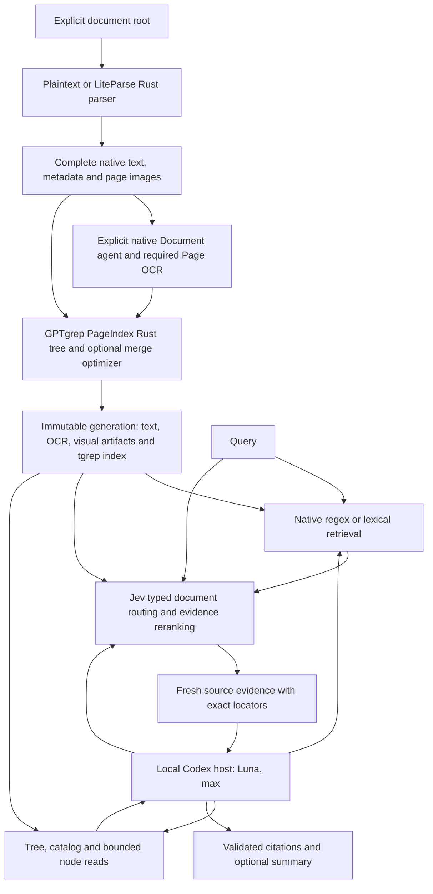

# GPTgrep architecture

English | [简体中文](architecture.zh-CN.md) | [日本語](architecture.ja.md)

GPTgrep gives a reasoning agent fast, inspectable access to local documents. It
keeps exact retrieval, probabilistic judgments, and model-written synthesis as
separate operations with separate receipts.
Jev routing and reranking are mandatory in default search and in the local
reasoning host. Exact primitives remain separately callable for inspection.



The current implementation and pending live gates are recorded in the dated
[experimental status](experimental-status.md). [Development setup](development.md)
separates ordinary local retrieval, native Page/Document runtime preparation and
the full62 paired SEARCH workflow. INDEX preparation is measured separately from
question-dependent SEARCH; PageIndex G5 remains a separate first-release gate.

## Module ownership

| Crate/interface | Responsibility | External runtime |
| --- | --- | --- |
| `gptgrep-pageindex` | Pure Rust page/section coordinates, heading hierarchy, bookmark composition, structural optimization | None |
| `gptgrep-parse` | Complete-document batching, UTF-8/native metadata, prepared images, OCR finalization and artifact provenance | PDFium for native documents; LibreOffice for Office conversion |
| `gptgrep-index` | Embedded tgrep-core, conservative trigram candidates, exact Rust-regex verification | None; no daemon |
| `gptgrep-jev` | Choice/Noul/Score Decisions transport, schema validation, bounded inference | Explicit OpenRouter request |
| `gptgrep-core` | Prepared-document toolbox, complete rich generation publication, source freshness, retrieval and evidence contracts | Required Jev for default hybrid and semantic retrieval |
| `gptgrep-host` | Native Page OCR and Document drivers, local Codex readers, tool dispatch and final citation validation | Caller-selected Codex installation/account |
| `gptgrep-cli` | Native argv, JSON, schema and grep presentation | None for local commands |
| `packages/cli` | Optional incur presentation and discovery wrapper | Node and published incur 0.5.1 |

Decisions defaults to `openai/gpt-6-luna-decisions`, with bounded flat typed
PNG/JPEG input and exact returned-model admission. `typesafe/jev-1.13` remains an
explicit text-only option. An explicit `~author/family-latest` alias is text-only
and admits only a concrete same-author, same-family build. Reports keep the
requested selector and the served model separate. One optional existing-ledger
`ExecutionContext` is shared by routing, reranking and host follow-ups. Joining it
never renews the original clock or consumed allowance. A new ledger is created once
by `gptgrep decisions-budget init`, and `status` observes it read-only. Native
Codex selection stays separate.

The host profile defaults are `model = "gpt-6-luna"` and
`model_reasoning_effort = "max"`, with `service_tier = "fast"`, as selected for this project. They are local
helper settings; they do not change the development agent's model. Runtime
`CODEX_HOME` selects an existing Codex configuration and authentication directory. The program does not read/copy auth
files, change global profiles, or perform an interactive login.
Native OCR and document-agent children explicitly select Codex-managed ChatGPT
authentication and the file credential store in this account home. The authorized
device login cache is reused while per-run state, logs and temporary files remain
separate. The selected Codex runtime owns token renewal. Named filesystem
permissions grant source images to model tools and keep the credential home
outside those grants; startup never combines them with legacy sandbox settings.
An optional `--codex-state-dir` selects a separate existing canonical directory
for native SQLite state and its existing `logs` child for logs. Authentication
continues to use `--codex-home`; callers route temporary and protocol trace files separately.
`--codex-permissions PROFILE` explicitly selects an existing named permission
profile on both the thread and turn. The host requires its acknowledged profile
ID before starting a turn and omits legacy sandbox overrides for that selection.
It requires network access to remain disabled and accepts the native read-only
projection or a workspace-write projection with no legacy writable roots and both
temporary-directory exclusions enabled. The acknowledgment and projection checks
identify the selected policy; actual filesystem denials require runtime verification.

Active-turn failures retain `host_protocol.diagnostics` (also available inside a
model-attempt protocol error) and matching private-trace `error_diagnostics`.
OCR runtime errors retain the same closed projection in `diagnostics`.
`gptgrep.codex.error-diagnostics.v1` distinguishes typed native variants, fixed
allowlisted error codes/types/parameter families from structured provider errors,
and explicitly labelled anchored message signatures. It can identify tool
definitions, output schemas, model selection, authentication, transport and
server failures when the observed error supplies that evidence. Classifications
describe the observed error evidence; they are not independently verified root
causes. Conflicting or unrecognized evidence remains `unknown`.

The projection never stores arbitrary error text, header values, URLs, request
bodies, model names from error strings, or rejected property names. It records
field shape and byte length, plus SHA256 only when the entire string is at most
16 KiB. Oversized fields are neither scanned nor hashed. The only text grammars
are complete JSON errors, a bounded `unexpected status` HTTP error envelope, and
fixed anchored error signatures. An HTTP envelope permits an empty suffix or
`, url: ` followed by one whitespace-free HTTP(S) URL of at most 2,048 bytes,
optionally followed by `, request id: ` and a 1–128-character ASCII identifier
containing only letters, digits, underscores or hyphens. Quotes, backslashes,
JSON braces and angle brackets are rejected in the URL; any other suffix or
second JSON value leaves the error unknown. Cause classification performs no
arbitrary substring JSON or keyword search. Structured `invalid_request_error`
messages may also report deduplicated words from a fixed API parameter allowlist
as `request_subject_hints`; these hints do not establish the cause and never
retain arbitrary words. Native retry handling, the original deadline, tool limits and
unknown usage accounting are unchanged. These diagnostics cannot recover the
cause of an earlier run whose error content was already discarded.

## Prepared-document agent

`gptgrep-core::parse_agent` owns one invocation's registered source pins,
opaque document/artifact/task handles, complete native extraction and shared
parser budget. Its foreground NDJSON facade supports complete paginated
inventories and bounded windows. Closing a handle invalidates its crop custody
even when reopening identical source bytes produces the same content-bound task
digest. JSON cannot provide paid OCR results or admit new source paths.

`gptgrep-host::parse_agent_driver` coordinates a selected standalone Codex
app-server document turn over that typed backend. Document defaults are 64 tools,
one turn and 900 seconds. An explicit native profile can bind a duration from
1 to 3,600 seconds; caller limits and the guard contract must match. Frontend,
session and original phase deadlines can still expire earlier. Required page OCR uses separate qualified page
children, each retaining eight tools, one turn and 180 seconds. Metadata and
parser completeness cover every original page; observed model inspection remains
separate and may be partial. Page windows are batch bounds, not a whole-document
page-count cutoff. Logical payload/metadata/staging accounting is reported as such;
it does not establish total process RSS or measured physical disk use.

The CLI exposes `parse-agent serve`, `run`, `agent` and `qualify`. Explicit
parse-agent index controls pin one document control for every selected supported
source. The generation writer consumes verified owned products without reparsing,
shares the original parser/OCR context, rechecks source pins and inventory, and
publishes only after complete admission. The portable native-viewer derivative
and its upstream license are under [patches/codex-native-viewer](../patches/codex-native-viewer/README.md).
Its native Page and Document qualifications remain independent of the existing
mediated DynamicImages transport and of compilation.

Encoded page-image capacity is configured in the existing parse-agent control's
`resources` object. The CLI consumes that control through `--config` and
`--expected-control-sha256`; `index` uses the pinned `--parse-agent-config`
control. Defaults are 1,048,576 image-file bytes, 1,398,104 base64 bytes and
4,194,304 image-file bytes per page. To admit a 4 MiB page image, set these three
fields in the complete control, retain its other selected resource fields, and
recompute its control digest:

```json
{
  "image_file_bytes": 4194304,
  "image_base64_bytes": 5592408,
  "image_file_bytes_per_page": 4194304
}
```

These are configurable capacities. The base64 capacity must cover the selected
file capacity, which must fit the per-page capacity. Checked pixel, decode,
working-memory and document/run staging admission still applies to actual work;
setting a larger encoded capacity cannot raise the original invocation's server
limits or replace its shared staging counter. Pixel/decode limits retain their
existing defaults and ceilings. Document and run staging capacities are caller
configurable; retained artifacts share the original invocation counter. Text-only work may select a smaller memory or
staging envelope without reserving unused image capacity.

Native Page profiles derive `image_limits` from those resources, with separate
`image_file_bytes`, `image_base64_bytes`, `image_wire_bytes` and
`image_transport_bytes`. The 4 MiB example derives 5,657,944 bytes per image on
the wire and 5,854,568 cumulative image bytes; the latter is also the profile's
`image_transport_reserved_bytes`. The wire allowance includes bounded JSON
framing separately from base64. Native Document controls and their guard profiles
carry the same typed per-image limits; the control's `image_wire_bytes` selects
the cumulative document allowance (32 MiB by default). The library helper
`document_native_image_limits` binds it to the parser resource budget. Both modes
copy the exact limits into admission and readiness evidence, and validate source
and prepared-image receipts against them. RPC frames retain their separate 4 MiB
limit. Image bytes are not admitted as RPC frames.

For the retained fixed Page/Document modes, changing a native binary, profile or
image-limit tuple requires fresh qualification for that tuple.
`OcrRuntimeProfile::unqualified_native_with_resources` derives a Page profile,
and the existing `native_page_probe` example accepts an optional `resources`
control object for its two-image qualification; omission retains the defaults.
These fixed-mode qualifications are scoped component evidence. The current D3
work is full native PTC parsing/OCR with the agent's native tools and Skills;
new fixed Page/Document qualifications are not prerequisites for that mainline.
Decisions retains its independent 1 MiB per-image contract, and the HTTP `/ocr`
compatibility endpoint retains its independent 1 MiB body-image cap.

## Ingestion and snapshot consistency

The corpus root is explicit. Normal ignore rules apply even outside a Git repo;
hidden entries, Git/runtime/build directories, credential filenames, private keys,
and symlinked source entries are excluded. Source paths remain inside the corpus.
Native parsing must cover every physical page. Missing dependencies, extraction
errors and textless scans with OCR disabled are errors, rather than successful
empty documents. Empty plaintext is a valid document with no evidence spans.

The writer holds an OS file lock. It creates a unique generation under
`.gptgrep/generations/`, reads and hashes source bytes, parses, then rechecks the
source digest. It writes canonical text and a typed source manifest, builds a
trigram index, verifies completeness, and atomically publishes `CURRENT.json`.
A failed build leaves the prior pointer unchanged. Old generations are retained;
automatic deletion is outside the index operation.

The pointer binds the manifest digest and generation. The manifest binds canonical
root, document IDs, source/text digests, parser identity, pages and nodes. Readers
reject duplicate identities, malformed spans/hierarchy and incompatible schemas.
The index adapter separately binds its file table and candidate text digests.
These checks detect accidental corruption; an index is not a cryptographically
authenticated artifact from an unknown third party.

`source_fresh=true` on a hit means its original source bytes matched the recorded
digest when checked for that retrieval. Selected sources are checked again after
remote inference. It is not a promise that every filesystem entry has been newly
discovered. `status` verifies existing indexed documents; `index` discovers added
files and establishes a new corpus snapshot. Negative searches refer to that
snapshot and must be interpreted with coverage/stale warnings.

## Retrieval modes

**Hybrid is the default.** The default workflow requires Jev routing and
reranking and rejects missing credentials or inference errors. The explicit regex
and lexical modes are local primitives, including for controlled ablations.
They are not a fallback after Jev failure. Default legacy parsing is local.
Explicit OCR and Document-agent indexing invoke native models; the publication
step accepts only complete source-bound products. `enrich` remains a separate
model-assisted navigation-overlay operation.

An optional exact document path scopes both trigram candidates and Jev routing
before any candidate limit. The report binds `document_scope`; `indexed_files`
counts the corpus while `scoped_files` counts the requested search scope.
Unknown or non-normalized paths are errors, rather than a silent whole-corpus search.

**Regex** uses tgrep's conservative trigram plan followed by matching the same
regex against original canonical UTF-8 lines. MatchAll plans scan candidates;
they never mean no hits. Unicode case folding and UTF-8 BOM handling require
conservative candidate expansion. Literal queries are escaped before planning.
The default context is zero, matching grep; callers request more with `-C`.

**Lexical** finds query-token matches using the same index, groups evidence by
tree node, and orders it by term coverage. This score is a local lexical measure,
not an embedding distance or calibrated semantic probability. Lexical and hybrid
queries use at most 16 terms: lowercase alphanumeric tokens, deduplicated, after
dropping a small fixed English function-word list and ASCII-letter tokens shorter
than three characters (tokens with digits and non-ASCII tokens are kept; a query
of only dropped tokens keeps them). When more than 16 remain, the first 64 are
ranked by document frequency in the scoped index, rarer first, terms absent from
the scope last and ties in question order, using the same verified
case-insensitive matching as search. The selection is deterministic for a
snapshot and scope.

**Hybrid** retains lexical candidates and adds a separate semantic tree lane.
Jev first judges bounded document descriptions containing paths, headings and
opening text. Selected document leaf nodes contribute evidence independently of
query-token overlap. A second, per-candidate Score pass orders the bounded union.
**Semantic** uses that tree lane without a lexical seed. Initial routing examines
at most 32 document descriptions and the final pass at most 24 candidates; this is
an explicit development budget, not exhaustive semantic search over a large corpus.
Routing selects the top-ranked documents regardless of score, so when exactly one
document can be routed (for example an explicit `--document` scope or a single
fresh indexed document) it is selected without a routing Decisions call. Its tree
candidates and the rerank request are unchanged, and `coverage.routing_status`
reports `skipped_single_document` instead of `routed`. The rich text initial pass
applies the same rule.
Coverage reports expose the inspected scope and truncation. Hierarchical corpus
routing and resumable expansion are subsequent scalability work.

Choice scores compare available options, so they are not used as absolute
relevance. The reranker applies the same concrete Score rubric independently to
each candidate, normalizes its expected level to 0..1, and retains optional
confidence. Neither score nor confidence proves truth. An omitted candidate cannot
be recovered by reranking. No confidence-based abstention threshold is presented
as calibrated until held-out evaluation establishes it.

The initial explicit relevance floor is 0.5 of the ordered rubric, an operational
selection policy. In hybrid mode exact atomic-token matches remain available via
the lexical lane and are marked `literal_anchor`; the model score is not rewritten.
This avoids allowing an uncertain semantic judgment to erase a proven grep match.
A delivered hit scoring below the requested floor carries `below_threshold: true`.
When no reranked candidate passes the floor (and none is a literal anchor), the
search does not return an empty set: it delivers the top three candidates by
score, each flagged `below_threshold`, counts them in
`coverage.below_threshold_fallback` (they remain in `filtered_candidates`) and
adds a warning that they are low-confidence candidates. The count and warning
describe the flagged hits actually returned after the result limit and the final
freshness check. They never count as passing; a host seed reports `filtered_all`.
Plain-text `search` prints them with grep's context separator (`PATH-LINE-TEXT`)
instead of as `PATH:LINE:TEXT` matches, and the exit status is 0 because hits are
returned. Evidence-role ordering applies the same fallback (eligibility
`below_floor_fallback`); the rich text/multimodal paths keep their existing floor
without it.
No-answer cases, literal queries and natural-language questions are separate evals.

Decisions uses `/api/alpha/decisions`, a 20-second request deadline, no redirects
or provider fallback, and at most 64 questions. The default text retrieval client
(search routing and evidence reranking, including ask/summarize initial and reader
searches) admits one bounded transient retry: only after a received HTTP 429, 500,
502, 503 or 504, at most once, with the identical request bytes. It waits a jittered
250-1000 ms, or a longer `Retry-After` of one non-negative integer number of
seconds (at most ten digits), and retries only if the original request deadline
still leaves that wait plus 2 seconds; the deadline is never renewed. A
`Retry-After` returned in any other form (an HTTP-date, a repeated field, or a
negative, fractional or longer value) refuses the retry instead of being ignored,
and the failure diagnostic records why (`retry_after_refusal`: `repeated`,
`out_of_range` or `not_delta_seconds`). The retry is a separate reservation in
the same execution context and is skipped when no submission remains; a later
call that the exhausted budget refuses fails with `Decisions submission budget
exhausted` before any send. Timeouts, connection or mid-body errors, parse and
validation failures and other statuses are never retried. Both attempts are
reported: the failed one keeps its HTTP status in `jev_retried_attempts` and counts
in `jev_calls_attempted` without a usage entry, so its unknown cost keeps accounting
incomplete. The retry counts as an attempt once admitted: a `before_retry`
progress receipt that already records the failed attempt is emitted before the
backoff, reservation and send, so cancelling the search during the retry cannot
drop either submission from the host ledger, and a receipt that cannot be recorded
stops the retry unsent. Planned query-view operations accept one such retry per
logical call, and a failed operation receipt keeps the retried attempt. An error
after the retry was sent (for example a failed local ledger record) is kind
`retry_post_send`. When the retry's reply had already validated, the provider
completed it with known usage: the failure diagnostic keeps that checked numeric
usage and served model, and the search error, operation receipt and host ledger
count it in `jev_requests`, `jev_models` and `jev_usage`; otherwise its usage stays
unknown. Only a retry stopped before its send is `retry_admission`. Judge,
enrichment support calls (their own explicit retry plan), navigation scans,
evidence-role decisions, rich/multimodal searches, explicit rerank pools and
batch submissions remain single-submission; the rich paths remove any retry
policy attached to a caller-supplied client. Text requests
and the escaped text/questions envelope retain a 64 KiB limit. Typed Luna image
requests have an 8 MiB complete-body limit, with at most four PNG/JPEG images,
1 MiB of compressed bytes and 8 million pixels per image, and 24 million pixels
in total. Base64 and JSON framing count toward the complete-body limit.
Malformed, missing, duplicate and mismatched responses fail explicitly. Returned
model and available usage/cost are retained; unavailable metrics remain null.

## Evidence and programmatic composition

Hits contain source-relative path, node ID, source SHA-256, physical page range,
line range, exact canonical UTF-8 byte interval, column offset, truncation flag,
score, citation and freshness. Plaintext byte/line coordinates refer to original
UTF-8 source. PDF/Office coordinates refer to canonical extracted text plus
physical source pages. Printed page labels are not substituted for physical pages.

Long snippets are bounded around the match instead of truncating preceding
context and losing the match. Text byte intervals preserve CRLF and Unicode.
The core precomputes line offsets once per document and stops formatting after
the requested regex result count, so output limits also bound presentation work.
Node reads provide `node_offset` and `next_offset` for bounded continuation.
Each delivered window is revalidated at its exact offset and length; native grep
context that crosses a node boundary retains its context and has no node cursor.

The native CLI is the canonical grep interface. Its optional incur wrapper passes
typed JSON requests to native argv without shell interpolation. MCP, updater and
skill-sync entry points are rejected before incur dispatch. `--schema` and
`--llms` expose a small discoverable programmatic contract.

## Local PageIndex-style reasoning

The local host uses Codex's stdio app-server, not a PageIndex cloud account and
not an MCP server. It exposes a bounded set of GPTgrep evidence operations to the
model. The caller owns question, root, timeout, tool-call budget and account home.
By default, the host performs initial Jev hybrid retrieval before starting the reader, then
supplies the bounded issued evidence in the first prompt. This stage cannot be
skipped by choosing a tree or read tool. Summaries constrain it to the selected
node's document. Subsequent searches default to hybrid. The host retains per-search
Jev coverage and usage alongside Codex usage, and the overall deadline includes
initial retrieval. Empty or stale scopes do not establish successful reranking.
Summary and retrieval use actual source evidence; model-produced citations must
resolve to evidence issued during that run and remain fresh at completion.
The retrieval reader's instructions (restricted and native) add two generic
answer rules: lead with the direct answer in the form the question asks for, and
commit to it, citing it, when the evidence read answers the question as asked;
and, when the question depends on a specific passage, resolve the in-text
references it relies on (footnote or endnote markers, citation numbers, see-table
or see-section pointers) by reading the referenced note or section before
answering. The rules say when to commit, never when to stop abstaining: every
evidence, citation and abstention rule is unchanged, including
`insufficient_evidence: true` when evidence is missing or cannot support the
answer. Rich text and multimodal readers do not receive these rules. In the
full62 paired comparison, the raw-only arm of a `legacy_text` run receives the
same rule text.

`HostConfig.native_ptc` (default false) and `--native-ptc` select native
execution for the final retrieval reader. An existing named permission profile
must be acknowledged before the turn. Native configuration inherits the selected
runtime's Code Mode, MCP, web and other capabilities, then applies
`HostConfig.native_capabilities`; shell and image viewing are enabled by default.
The runtime owns the named policy. Its reported sandbox projection is retained
as private observation and does not establish granular enforcement. Query
planners clear the flag and pure completion rejects native execution.

`native_ptc::Tracker` counts native command, image, file-change, MCP, collaborator,
web, generation and sleep items after thread/turn binding. Lifecycle events and
one final snapshot for an ID count once; changed kinds or inconsistent statuses
fail. These observations and direct GPTgrep request IDs share the job's configured
`max_tool_calls`. A dynamic excess is denied before dispatch; an observed native
excess stops the host after execution may already have started. Reports retain
hashed IDs and lifecycle/status metadata without commands, output, image paths,
cwd or process IDs. GPTgrep tool receipts and citation validation retain their
existing meaning.

`run_native_task` provides structured native work with caller instructions,
state, JSON schema, working directory and original deadline. It validates the
actual final JSON, captures native usage and permission observations, and returns
a report only after the owned process group is stopped and reaped.
`OcrRuntimeProfile::with_native_agent` selects this path for `OcrHostExecutor`.
The agent can inspect original source and supplied renditions, run code and CV
libraries, and choose useful image derivatives. Source hashes are checked before
and after execution; the typed OCR validator checks task identity, required
regions and completion before the existing parser can ingest the result. The
private native report is retained by digest, and portable receipts distinguish
native execution from the older guarded-image transport. Cancellation retains
unknown provider accounting while owned process cleanup is awaited.

Document controls use an explicit `native_execution` selection at the existing
Document driver. It retains the real `gptgrep_parse.toolbox` operations and
complete backend verification while inheriting native runtime capabilities.
Legacy fixed Page/Document image profiles and qualification receipts remain
available for their original execution modes.

Authentication, source retrieval, inference, citation validation and task
acceptance are separate outcomes. A successful child process is insufficient.
The host reports actual thread/turn identity, effective model/effort, tool calls,
usage when supplied, and final validation. These runtime identities remain private
when results are used in project delivery receipts.

## Flash rewrite boundary

The raw Flash pipeline has substantial character/font/layout repair, multilingual
heading detection, outline validation, bookmark tiers and optional model passes.
LiteParse layout is currently an alternate geometry front end. The Rust tree and
merge stages carry explicit source mappings and tests; identical JSON shape alone
does not establish algorithm parity. Local Codex summaries and reasoning replace
the corresponding agentic service role, while Flash extraction parity remains a
separate stage-by-stage differential evaluation. See the source research and
crate notices for implemented stages and remaining differences.

## Optional reasoning-index enrichment

Default legacy `index` publishes the deterministic LiteParse/tree/tgrep
generation without a model call. Explicit OCR/document-agent indexing is a
separate implemented path with declared native effects. Explicit `enrich` then traverses every admitted document through a
source-pinned UTF-8 byte cursor. Its no-model plan binds all windows and worst
case budgets; live Codex (builder default `gpt-6-luna`) proposes small closed
schema hints, and Jev classifies their support against exact raw anchors.
Builder/Jev attempts use a separate durable ledger, and validated complete
windows can be reused after a safe budget pause. Incomplete work does not
publish an active overlay. A complete overlay has its own atomic pointer bound
to the original generation and source bytes. Hints are navigation-only data:
they neither rewrite tree coordinates nor grant citation authority. Ordinary
`ask` does not consume this overlay. A scoped, planned `ask` can explicitly
require one overlay SHA. Before any planner call, the host validates the overlay
and source, scans all eligible Chunk/Node hints, prepares every bounded Jev
Score batch, and rejects the entire scan if its declared budgets cannot admit
it. Scores are merged globally into at most eight whole hints (8 KiB total).
The planner and reader receive the same packet as untrusted navigation data;
only normal search/read operations can issue citable evidence. Partial Jev
failure is explicit and retains attempted-call accounting. Live quality benefit
is not inferred from this integration alone.

New enrichment plans may declare `--support-retries 0..2`. Only eligible Jev
timeout, transport or transient HTTP failures can make at most two extra
submissions across the whole ledger. Each uses the same prepared request bytes
and a separate durable reservation, receipt and bounded backoff; unknown costs
remain unknown. The default is zero, preserving older plan hashes. A terminal
failed builder or support window can continue only with explicit
`--resume --rebuild-failed-window CALL_ID`: completed windows and failed
receipts remain, while the failed window's builder is a **new** model sample,
never an identical replay of an unavailable legacy support payload. At most
two rebuild admissions are allowed per ledger. Neither path retries a
completed answer.


## Experimental query planning

The default-off ask option `--experimental-query-plan` inserts one separate
`gpt-6-luna`/caller-selected-effort/fast completion by default before initial
retrieval; the normal effort default is max. The
planner model can be selected explicitly with `--planner-model`; the final
reader retains its separately selected profile. The planner receives only the
original question, fixed scope and bounded source-derived descriptors. It can
propose zero to two retrieval phrases, never a new scope or citable evidence.
The original question remains unchanged.

Core collection pins one generation and overlaps at most two document-routing
operations. It keeps distinct windows in a node, deduplicates exact source spans,
and selects a stable round-robin union capped at 24 candidates. One final Jev
pass evaluates that union against the original question. Only original-view
literal anchors can bypass the relevance floor. The host owns evidence issuance
and applies the existing output cap before citations become available.

This is parallel independent first-hop retrieval; later dependent hops still use
the existing reader loop. Planner and reader share one absolute deadline, and
planner/branch failures are explicit. Per-operation Jev receipts and separate
model-attempt records retain identities, usage and unknowns on failures. Parent
totals do not add nested totals twice; legacy `usage` covers only the final reader.
Extra planning/routing work and candidate displacement are measured treatment
costs. This feature makes no indexing, multi-reader voting or quality claim.

`--experimental-source-continuation` is another default-off option for a
single-document planned `ask`. It adds reader-only guidance to inspect verified
adjacent tree/read nodes when a requested claim remains unresolved at a node
boundary: `next_offset = null` ends that node, not the source inquiry. It does
not grant unseen text citation authority or increase tool, time or output
budgets. The flag and guidance digest are source-bound in the report; the
disabled reader instructions remain byte-identical. Its quality effect needs
a separately frozen full-cohort ablation.

## Experimental evidence roles

The ask-only `--experimental-evidence-roles` flag requires query planning and is
off by default. The planned union uses one unchanged relevance Score and one
four-way Choice per exact source window in the same mandatory Jev request. The
24-candidate cap allows at most 48 questions; the hard limits remain 64 questions
and 65,536 encoded request bytes. Shared role definitions are bounded to 2,048
bytes. Admission measures the complete request, including escaping and metadata,
and rejects overflow explicitly.

Eligibility and the original literal-anchor bypass are unchanged. When no window
is eligible, the three highest-scoring windows become `below_floor_fallback`
candidates, flagged `below_threshold` as in the ordinary relevance path. Eligible
windows sort by original anchor group, role (`direct_support`,
`source_local_incomplete`, `background`, `no_support`), descending relevance, then
stable source coordinates. Direct support covers at least one requested fact;
it does not certify every constraint or the reader's later answer. The delivered
set always reports sufficiency as unassessed. Existing bounded reads can resolve
local fragments; no hidden read or extra model step is introduced.

Assessments bind generation, path, source digest, byte interval, text digest and
original-question/decision hashes. The host issues evidence after whole-hit
packing. A changed interval or text digest invalidates the delivered role hint;
the original and delivered scopes remain distinct. Role confidence and optional
distributions remain diagnostic metadata and do not replace relevance confidence.
Unseen bytes remain uncitable.

Up to 24 private judged-candidate records retain eligibility, score, role, rank
and actual omission/delivery disposition, with a shared source table and no source
text. Their encoded block is bounded to 24 KiB within the existing ledger entry,
event and total-byte limits. Reservation/persistence failures remain explicit.
Rejected-candidate records never enter reader context or issue citations. Final
question counts, request/rubric hashes, usage and cost belong to one union
operation. Extra questions can increase token use and latency even when request
count is unchanged. The normal relevance path remains available as the declared
control; mandatory Jev and all caller budgets are preserved.
