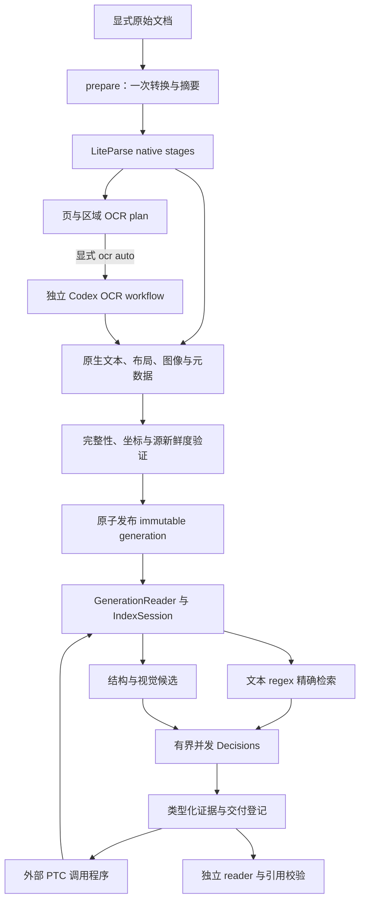

# GPTgrep：PTC 批量检索、多模态 Decisions 与 Agentic OCR

状态：保留的技术设计合同；原始核查日期为 2026-10-07。实现与运行验收持续推进。
截至 2026-10-12，原生 parse/OCR、rich 索引和检索已有实现，完整 full34／full62 验收仍未完成；
当前状态见[实验摘要](../experimental-status.md)，可执行准备步骤见[开发说明](../development.md)。
设计基线：`cc43c2aa2130bb3721f8613e6dbbad1accd33389`。
本文描述目标行为；当前可执行接口仍以 [SPEC](../../SPEC.md)、[架构](../architecture.md) 和原生 `--schema` 为准。
研究记录、Exec Build Plan、运行凭据与审查记录分别保存在忽略的 `docs/research/`、`workspace/exec-plans/`、`workspace/handoff/`。

## 1. 目标与可验收结果

将 GPTgrep 做成外部 agent 可以编程组合的文档检索库与原生 CLI：在固定 generation 上批量执行 regex、结构浏览和读取；召回文本与视觉候选；用并发 Decisions 排序；显式启用 OCR 入库后自动选择需要识别的页或区域。PTC 指调用方程序编排这些操作，不引入 MCP、常驻搜索服务或产品内通用代码执行器。

“超越 rg”是需要分解验证的假设：在重复查询的静态语料上减少候选读取；一次批量调用摊薄加载成本；通过文档结构、视觉与 OCR 找回词面无法覆盖的证据。单次小文件 regex、冷建库及 OCR 成本可能更高，不能预先宣称全面更快或更准。

本迭代的功能完成条件是下文 D1–D7 全部有证据，并通过独立审查。首次公开实验 release 还须满足既有 PageIndex G3–G5；这轮公开／合成夹具对照不能替代完整 62 任务验收。文档完成、源码交付、功能验收与首发资格分别记录。

| 子目标 | 业务结果 | 必需证据 |
| --- | --- | --- |
| D1 引擎 | 指定 tgrep pin 上保持精确 regex 语义 | 发布身份、来源许可、indexed/direct differential |
| D2 Decisions | Luna 可正确评估文本和真实图片 | 网关 wire 合同、图像变体／缺图对照、并发与失败账本 |
| D3 解析 | 一次转换产生完整可追溯文档产物 | 页数、布局、截图、变换、结构与元数据夹具 |
| D4 OCR | 必需内容可靠转录后才发布新 generation | 页级状态机、真实图像交付、失败原子性与恢复测试 |
| D5 PTC | 批量操作与逐条等价且固定 generation | ID／顺序／覆盖率／计量及并发发布测试 |
| D6 多模态证据 | 视觉候选可召回且引用只绑定实际交付的内容 | 无关键词图表、类型化引用、陈旧与未读拒绝 |
| D7 对照交付 | 用有界对照限定改进适用范围 | 冻结配置、完整分母、指标、独立审查、PoUW 与备份 |

## 2. 已核实事实与版本选择

| 对象 | 基线实现 | 本设计目标／结论 |
| --- | --- | --- |
| tgrep-core | `239711cfb6e69e8780cabf912a8987162a223ff1`，v1.0.9 | 采用核验时最新稳定发布 v1.1.0 / `1120aca41dd192ae61bdd996e9886cb354a78a27` |
| tgrep 版本策略 | 允许采用最新稳定发布包 | 实施里程碑开始时核验 release/tag/package identity，再固定commit与lock用于构建和对照；不使用浮动HEAD |
| LiteParse | `a7105d3e3cfaf001970578c6615f6e71015aa483`，2.14.6 | crates-v2.15.1 / `ab8879623ee45a0b7a775d12b42a9a7ae9dab16b` |
| Decisions | `typesafe/jev-1.13`，文本 Candidate，OpenRouter alpha endpoint | 目标默认 `openai/gpt-6-luna-decisions`；旧模型可显式选择作文本对照 |
| Parser | OCR 禁用；整份 native 文档无文本时失败，混合文档仍可能含未识别的扫描页 | 新增显式 `index --ocr auto` 与逐页覆盖状态；普通 index 仍无模型调用 |
| Host | Retrieval 与无工具的文本 Completion 两种 workflow | 新增 OCR workflow 与多模态 reader；保持模型角色独立 |
| Batch | 顶层接口每次重开 CURRENT | 需要共享 reader，不能仅在 CLI 循环现有函数 |

来源：[tgrep 发布列表](https://github.com/microsoft/tgrep/releases)、[v1.1.0](https://github.com/microsoft/tgrep/releases/tag/v1.1.0)、[LiteParse 2.15.1](https://github.com/run-llama/liteparse/releases/tag/crates-v2.15.1)、[OpenRouter 模型](https://openrouter.ai/openai/gpt-6-luna-decisions)。当前tgrep发布记录的发布时间为2026-10-07 05:09:42 UTC，release API与tag ref均指向`1120aca…`；较早的`8ae6090…`观察仅保留为历史证据。版本身份与源码检查成立，不代表这些目标已被GPTgrep编译或运行。

v1.1.0包含inline case-insensitive修复，并修复fixed-string helper的Unicode casefold：大小写不敏感literal经escaped regex planner生成保守候选，无法规划时MatchAll扫描。GPTgrep继续用同一Rust regex做精确验证；现有escaped-regex路径可保留，native literal helper可在adapter parity证明后使用，不再将旧版风险描述成此版本缺陷。新版本的indexed path traversal校验与vendored `ignore`、平台依赖变化纳入M1测试和许可证核查。[固定query源码](https://github.com/microsoft/tgrep/blob/1120aca41dd192ae61bdd996e9886cb354a78a27/tgrep-core/src/query.rs) · [v1.1.0发布记录](https://github.com/microsoft/tgrep/releases/tag/v1.1.0)

内嵌最新`tgrep-core`不等于采用上游CLI的全部运行方式。共享worktree/overlay APIs可作为后续库内复用研究；本轮仍用GPTgrep的generation所有权与reader合同，不自动启用上游daemon、MCP或agent安装器。更新版本时重新检查API、lock/许可证、路径安全和索引兼容性，冻结实验后不在运行中移动pin。

## 3. 模块与数据流



| 所有者 | 改造责任 | 禁止越界 |
| --- | --- | --- |
| `gptgrep-parse` | prepare/native stages、RichParsedDocument、OCR plan／结果校验、`OcrExecutor` trait | 不依赖 core 或 host，不读取问题／gold |
| `gptgrep-pageindex` | 继续负责纯结构与坐标；接收解析的文本／层级视图 | 不放 provider、图像传输或宿主会话 |
| `gptgrep-index` | 指定引擎 pin、IndexSession、artifact 映射、精确 regex | 不让视觉分数产生 regex 命中 |
| `gptgrep-core` | generation v2、GenerationReader、批量预算、召回、证据验证与原子发布 | 不启动 Codex、不持有 evaluator 状态 |
| `gptgrep-jev` | typed Decisions 输入、网关 codec、Prepare/Submit、响应验证 | 不解释 arbitrary JSON 为图片、不隐式切 provider |
| `gptgrep-host` | OCR executor、app-server 工具、reader 图片交付、执行账本 | 不借普通 Retrieval 对 OCR 做 Jev 预检 |
| CLI / incur | 依赖注入、stdin 有界 JSON、schema／llms／参数一致性 | 不以 shell 插值或 MCP 暴露新接口 |

初期保留 crate 名 `gptgrep-jev` 与旧 `--jev-model` 参数作为兼容面；内部可新增 `DecisionsClient` 并保留 `JevClient` 别名。共享默认只改变 Decisions routing、rerank、角色判定和 support callers；planner、reader、judge 和 OCR 的模型各自配置，历史实验不改写。

## 4. generation v2 与证据契约

新增明确的 `gptgrep.manifest.v2`，把 manifest 版本与 CLI 响应版本解耦。每个文档保留 source digest、parser/engine identity、conversion digest、选项摘要与稳定 ID；每个 artifact 有 kind、SHA-256、长度、媒体类型、所有者、物理页与坐标系。路径只在验证的 generation 内解析，拒绝穿越、软链接替换、重复 ID 和摘要不符。

推荐产物布局（逻辑示意，实际文件名由 ID 决定）：

```text
generation/
  manifest.json
  sources/<document-id>/native.txt
  sources/<document-id>/layout.json
  sources/<document-id>/structure.json
  sources/<document-id>/ocr/regions.json
  sources/<document-id>/ocr/text.txt
  sources/<document-id>/merged.txt
  renditions/<rendition-id>.png
  text-index/...
```

`native.txt` 与 `ocr/text.txt` 是可独立验证的文本证据。`merged.txt` 用于树和阅读，附 segment map 映射回原产物；跨 segment 无法给出完整来源映射的结果不得生成单一原始文本引用。Markdown 是派生视图，不能丢弃完整文本或取代原始 OCR 产物。正文合并时的去重不删除 OCR 原始区域中的刻度、图例和轴标签。

当前索引把文本路径 stem 当 document ID；v2 必须显式存 `artifact_id → document_id / page / evidence_kind`。原生与 OCR 两条文本流可分别建候选项，regex 不跨 artifact 边界；汇总时按证据身份去重，保留来源类型。

`EvidenceRef` 为封闭的 tagged union：

| kind | 必需定位 | 语义 |
| --- | --- | --- |
| `native_text` | generation、document、source digest、text artifact digest、byte `[start,end)`、line、page | 精确匹配已保存的原生／解析文本 |
| `ocr_text` | 上述字段加 OCR artifact、region IDs、OCR profile/receipt digest | 精确匹配已保存的识别结果，不宣称原图上字符识别正确 |
| `visual_region` | generation、source digest、物理页、region、rendition digest、bbox、transform | 实际交付图像中的区域；没有伪造的 byte／line |

资源 ID 在同一 source/parse identity 下确定，generation 显式命名空间化。重建变化后旧 ID 不自动指向新字节。视觉坐标统一为旋转修正后的页坐标；保存原始 PDF 坐标到页、页到 raster、raster 到 crop 的仿射变换及逆变换。验证有限数值、可逆矩阵、正面积、页内边界、像素尺寸与 crop source digest。

发布时包含完整页图和已计划的区域图。发布后的 `render` 直接读取这些 manifest 产物；交互式新 crop 写到 generation 之外的有界派生缓存，绝不修改 manifest 或 CURRENT。派生 ID/receipt 绑定 parent rendition digest、generation、source/page、crop transform、encoder/version/options 与输出 digest；只允许从已验证的 parent pixels 派生，拒绝调用方自报的 lineage。visual evidence 区分 `manifest` 与 `derived` 来源，后者须验证原始 parent、派生配方和输出字节；操作期间pin住cache entry，缓存丢失可依同一配方重建，但不可指向新 generation。源变更仍失效，缓存本身不授予引用权。

Reader 的 `DeliveredEvidence` 登记本绑定本次已交付的文本窗口／图像。inspect 元数据、rerank 看过但未交给 reader 的图像、仅有文件路径都不产生 reader 引用权。结束时重新校验实际引用的 source 与 artifact；篡改、删除或陈旧使引用失败。纯文本 CLI 输出继续兼容；只有显式多模态命令返回新版 evidence 响应。

旧 generation 保留且不就地修改。v1 reader 可继续读旧文本 generation；v2 功能遇到旧 manifest 返回 `rebuild_required`。重建成功后才切 CURRENT，回滚只切回已验证且仍新鲜的旧 generation；不自动 prune。

## 5. 一次转换与 Agentic OCR

### 5.1 解析阶段

按事务创建 `PreparedDocument`：原始输入、格式、原始摘要、转换文件摘要、converter/version/options、页方向、坐标变换。Office／独立图片只转成一次共同解析输入，解析、截图与 OCR 使用同一份产物。记录转换后物理页与原始格式的映射能力；没有 Office 原生页号时不虚构。

使用 LiteParse 2.15.1 的公开 stages：同步 PDFium 阶段提取raw pages、原生文字/几何、矢量、tagged PDF/XFA元数据，调用仍需Document的`page_complexity(document, page)`保存OCR必要性信号，并准备页图与截图信号。结束Document与持锁Library作用域后，纯数据阶段计算`layout_complexity`与OCR分流plan，再await并发OCR。大文档以有界页窗口预处理，复用同一转换文件，限制驻留图像与内存；不为每个区域重新转换。`project`、`document_signals`与blocks分类是纯数据阶段，不假称其必须持有PDFium。[LiteParse stages](https://github.com/run-llama/liteparse/blob/ab8879623ee45a0b7a775d12b42a9a7ae9dab16b/crates/liteparse/src/stages.rs)

`ParseSession` 的转换状态不是公开 stages 类型。实现应隔离一个固定 revision 的窄 adapter，选用导出但 `doc(hidden)` 的 `conversion::resolve_pdf_input` / `PdfInputGuard`，或以同一 session 同时产生解析与截图；不得把隐藏转换接口写成稳定公共 API。用 converter invocation count=1 和共同摘要验证最终选定路线。`render_form_fields` 保持关闭，避免为读取 XFA metadata 启用 document-open/JavaScript actions。[转换源码](https://github.com/run-llama/liteparse/blob/ab8879623ee45a0b7a775d12b42a9a7ae9dab16b/crates/liteparse/src/conversion.rs) · [配置源码](https://github.com/run-llama/liteparse/blob/ab8879623ee45a0b7a775d12b42a9a7ae9dab16b/crates/liteparse/src/config.rs)

所有元数据记录 `present / absent / unsupported / failed`，不能把缺字段写成空且成功。特别是 XFA extraction 不能承诺动态表单的完整可视渲染；用已选 PDFium 能力和夹具确认。LiteParse server 的瘦响应不作为主数据合同，GPTgrep 直接消费 Rust stages 的丰富结果。

### 5.2 自动分流与任务合同

拟新增：`gptgrep index ROOT --ocr auto --plan-only --json`。plan-only 可以执行本地转换、native parse 与截图来形成准确计划，并将结果写入未发布候选；零模型调用、不发布 CURRENT。默认 `--ocr off` 不启动任何模型，原有无法完整提取时的失败语义保留。

逐页记录 native 字符／区域覆盖、可见 raster／矢量证据、garbled/broken-font 信号、复杂度、选定区域与原因。无文本且存在内容、明显文字缺损、无法可靠提取的区域优先；复杂布局本身只增加检查信号，不强制 OCR。真正空白页必须有可解释的空白证据，不能因解析失败被归类为空白。

`OcrTask` 绑定 source、prepared artifact、页、regions、renditions、transform、parser/profile/schema digests、输出上限及预算。任务不含检索问题、benchmark ID 或 gold。parser 定义 `OcrExecutor` trait，CLI 将 host executor 注入 core 的 index options；trait 使用 owned DTO/有界 future，不能让 `PdfDocument` 跨 await 或 Send 边界。

OCR 目标模型按用户补充选择为 `gpt-6.1-luna`，默认 max / fast，独立于 Decisions 与问答模型。启动前核查所选 runtime 的 model/effort/tier/image 能力；不可用时明确阻塞，不替换模型。每页一个 app-server turn、最多 8 次工具调用、180 秒；默认并发 2。区域任务在该页 turn 内聚合，未完成不能拆成隐形新 turn。

OCR 的独立资源预算在 M0 冻结，不能沿用 Decisions 上限便宣称有界。初始提议：单张交付PNG/JPEG文件≤1 MiB、base64≤1,398,104字节、≤8 MP、像素解码缓冲≤32 MiB；每页≤4张且合计≤24 MP／压缩文件≤4 MiB。单页持久化布局≤4 MiB、整文档metadata≤64 MiB、单次送入native/layout文本≤64 KiB；OCR JSON≤256 KiB、≤1,024 regions、单region文本≤16 KiB。app-server单frame≤4 MiB、会话总传输≤16 MiB（含可能重复回传的图像）；raster/metadata拥有的数据工作集≤256 MiB、单文档staging≤512 MiB、整次转换／图像staging≤1 GiB。

压缩文件、base64和像素缓冲是不同计量。像素乘法先检查溢出再分配，完整文档signals受metadata上限约束；不能靠抽样漏页换取成功。所有图像、metadata与事件回显在分配/提交前受admission检查，未验证这些限制前M3/M4不准入。工作集限额不等于PDFium/模型进程总RSS上限，另测peak RSS。超限保留失败候选，不静默丢必需区域；任何下采样或重编码产生新rendition/transform/质量状态，预算内无法忠实识别时阻塞发布。

动态 GPTgrep 工具提供 native text、布局、完整页图与裁剪。实际图像交付支持经验证的 app-server 图像 content；同时纳入 runtime 原生 `view_image` 路径：当前 `base_config()` 禁用了它，OCR workflow 需单独开放。原生路径仅允许已校验的隔离页图目录，并将 image-view 计入同一工具预算；不能把事后观察 `imageView` 当作调用前权限与硬上限。如果所选 runtime 无法落实路径限制或 8 次调用上限，该路径不准入；显式选择已验证的动态图像工具路径，或报告能力阻塞。两条路径都必须保留图像摘要、交付事件与视觉对照结果，只有文件名／文本描述不算交付。[Codex app-server](https://developers.openai.com/codex/app-server)

输出为 schema 约束的忠实转录：region ID、原文、区域框、reading order、language、`recognized / partial / unreadable / blank` 与未识别范围。不得根据题意补全或推理缺字。schema 验证不证明 OCR 正确，字符与区域准确率另行评测。

### 5.3 状态机、合并与恢复

```text
planned → reserved → submitted → received → validated → merged → publish_ready
                          ↘ failed / completion_unknown
```

提交前持久化页 reservation 与 request binding；失败、超时及未知完成消耗 admission。无自动重开、无隐式 provider 重试；app-server 内部恢复通知单独记账，不冒充可观察的物理请求数。`--resume` 只复用摘要、profile、schema 与 freshness 都一致的 validated 产物；unknown 不能作为免费重试。额外尝试需要明确的新 admission 且占总预算。

先保存每个原始 OCR region，再执行合并；LiteParse 的 `merge_ocr` 可能过滤图表标签，且其成功条件弱于“全部必需任务完成”，因此不能直接把其返回成功作为 publication gate。GPTgrep 必须逐项完成选定任务；`unreadable` 或不满足计划完整度的 `partial` 作为阻塞，保留未发布产物。经验证的 blank 可作为完成状态。

最终合并完成后统一重做 `project → document_signals(完整文档) → blocks/reading view/tree`，再生成 byte/line offsets、segment maps、node IDs、artifact digests 与文本索引。前置 native-only 分类只是 OCR plan 的输入，不沿用其过期的最终正文坐标；原始native/OCR artifact及其坐标保持独立。改变批大小不应改变最终结构。完成这些校验并再次检查整个选定 source set 后，才原子发布 manifest、图像、OCR 与索引。

### 5.4 前台 OCR 适配

`gptgrep ocr serve` 仅显式前台启动，默认 loopback。GPTgrep 入库直接使用完整 `OcrTask` 接口；LiteParse `/ocr` 兼容路由是独立适配，保留上游 request/response 结构，不能假称携带完整 source lineage。图片大小、数量、响应与并发均受同一预算限制。兼容调用的来源完整度不足时只能返回 OCR 结果，不可直接发布 GPTgrep generation。绑定、身份校验、取消与超时列入协议测试；不改变全局 proxy、服务或账号配置。

## 6. Decisions：内部类型、网关验证与并发

内部定义 `DecisionInput { parts: Text | Image, evidence_bindings }` 与 `Predicate | Choice | Score`，图片是经过验证的字节资源及 MIME/digest，禁止靠 arbitrary JSON key 猜测模态。按 transport 映射字段：

| 合同 | OpenRouter（本轮实际链路） | OpenAI 原生（研究对照） |
| --- | --- | --- |
| endpoint | `/api/alpha/decisions` | `/v1/decisions` |
| model selector | `openai/gpt-6-luna-decisions` | `gpt-6-luna` |
| shared evidence | `state` | `input` |
| questions | 以 ID 为 key 的对象 | 含唯一 `name` 的数组 |
| boolean type | `noul` | `predicate` |
| image encoding | schema 尚未给出明确约定，待 D2 锁定 | user content 的 `input_image`、inline base64 data URL |

OpenRouter 模型页声明图像输入；核查时 OpenAPI 的 `state` 仍为 string/object/array，未定义图片 content parts，模型页链接的 `/docs/guides/community/multimodal-decisions` 实测 HTTP 404。OpenAI 明确要求 inline base64，不接受 hosted URL/file_id；这不能证明 OpenRouter 接受相同编码。文档或一次 HTTP 200 都不能替代视觉对照。[OpenRouter API](https://openrouter.ai/docs/api/api-reference/alphadecisions/submit-a-decisions-request) · [OpenRouter schema](https://openrouter.ai/openapi.json) · [OpenAI Decisions](https://developers.openai.com/api/docs/guides/decisions)

**D2 准入程序**：冻结网关 schema／请求字节和目标模型；先验证文本三种类型与 response identity；再对文字完全相同、图像答案相反且无文本泄漏的合成 pair 测试图片判定，交换顺序并加入缺图控制。缺图必须与对应有图输出可区分（或明确拒绝／未知），不能把猜中一次当成图像支持。记录实际返回模型、request/response hashes、usage/cost/latency、拒绝与错误。格式未锁定、模型错配、图片未消费或对照失败均阻塞正式默认切换；保留试验分支，不切 provider、不把图像静默变成文本。OpenRouter refusal 的实际编码同样需确认；内部将拒绝作为独立非评分结果，未知 wire type 明确失败。

独立候选的一组 Score／Choice 合并到同一请求；依赖 routing 结果的 rerank 分下一阶段。一个库内 `ExecutionContext` 默认最多 4 个在途 HTTP 请求，共享 semaphore、总提交额度、字节额度和绝对 deadline，不能每个子 batch 各建 4 个槽。64 是本地问题上限，不跟随模型宣称的 200 自动扩大；多项问题消耗 question 数而非仅候选数。

外部多进程 PTC 使用显式 `--budget-ledger FILE`：账本绑定 run ID、冻结plan digest、同机时间锚与绝对deadline、Decisions/OCR计数及在途槽。所有子命令传同一账本，OS文件锁下原子校验/预留并durably写入后才发送；作用域不跨主机。进程崩溃且完成未知时，提交额度不退回，在途槽保守隔离到该run结束，不能凭PID消失或lease过期当免费重试。完成/失败的槽释放须有终态或确认取消证据。单独CLI不提供账本时，只保证该invocation的上限，并在输出标明budget scope；不声称多个独立CLI自动共享限制。首次200/24对照必须共用一个账本，不能复制上限给每个worker。账本是本地文件协调，不启动daemon。

| 初始本地预算 | 文本 | 多模态（设计值，D2 后冻结） |
| --- | --- | --- |
| questions/request | ≤64 | ≤64 |
| 完整 encoded request | ≤64 KiB | ≤8 MiB，文字部分仍 ≤64 KiB |
| 图片 | 无 | ≤4 张；每张 decoded ≤1 MiB、≤8 MP；合计 ≤24 MP |
| response | ≤1 MiB | ≤1 MiB |
| HTTP 时限 | ≤20 秒且不超过父 deadline | 同左；若不足作为失败证据，不运行中自动放宽 |

完整 base64、envelope、题目和元数据全部进入实际字节测量。超限在提交前按稳定候选 ID 分组；单项仍超限显式错误，不截掉图片或改变 rubric。不同 batch 复用共享 state 时仍按实际重复发送的字节／tokens 计量。序列化一次，再持久化 reservation，最后 `submit_prepared` 一次提交；拒绝、429、timeout、坏 schema 与未知使用量都保留。

响应必须 exact ID set、无重复 key、类型正确、概率有限且合法、Score 范围正确；缺失和重复不能补零。保持原有统一四级相关性 rubric 和归一化方式；Score 不是答案正确概率。并发收集后按分数及稳定 ID 排序。某个 rerank 项失败时不给假分；batch 可报告该项失败，但默认 search/ask 的必需 Decisions 失败仍使该 operation 失败，不静默降为纯词面结果。

## 7. PTC 接口与共享 reader

### 7.1 入口

以下均为待实现接口，以实现阶段的版本化 JSON Schema 为最终合同。

| 接口 | 行为 |
| --- | --- |
| `batch --root ROOT --input - --json` | 一次加载 generation，独立执行带唯一 ID 的操作 |
| `search / tree / read` | 复用 GenerationReader、已验证 IndexSession 和有界文本缓存 |
| `inspect --resource ID` | 按字段投影读取页／区域／结构元数据；有分页 |
| `render --resource ID` | 校验或生成 source-bound rendition，返回有界资源描述／显式图像通道 |
| `rerank --root ROOT --input - --json` | 只接受来源绑定且在当前 reader 下可解析的候选 |
| `search / ask --multimodal` | 启用视觉 lane 与新版证据交付；不自动运行 OCR |

generation pin 有两种选择：请求提供 exact generation，或进入操作时解析 CURRENT 一次再返回实际 pin。后续外部 PTC 调用把该 generation 传回；不得把 cursor 默默迁移到最新版本。

### 7.2 Batch 示例与失败规则

```json
{
  "schema_version": "gptgrep.batch.request.v1",
  "generation": "CURRENT",
  "budget": {"max_operations": 64, "max_output_bytes": 1048576, "max_decisions_submissions": 8},
  "operations": [
    {"id": "exact-1", "op": "search", "query": "(?i)retention", "mode": "regex", "limit": 10},
    {"id": "tree-1", "op": "tree", "document": "manual.pdf", "fields": ["nodes.id", "nodes.pages"]}
  ]
}
```

返回 `{schema_version, generation, execution, items, coverage, metrics}`；execution显示run/plan binding与`invocation/shared_ledger`范围。items 始终按输入顺序包含 ID、`ok/error/not_executed`、结果或稳定错误码、覆盖与逐项计量。stdin ≤1 MiB、≤64 operations、默认总输出 ≤1 MiB；字段／页大小／缓存／图像全部有独立上限。预算初值须由 schema 声明，caller 只能在硬上限内调低或提高。

顶层 schema 错、重复 operation ID、generation/manifest/index 完整性失败在派发前拒绝整个 batch；单项 regex 错、资源不存在、源陈旧或 provider 失败只标记相关 item。执行中发现共享索引损坏会让 batch 失败，已付费动作的账本仍返回可检索 receipt。全局耗尽时剩余项标记 `not_executed`，不省略。

并发开始前按输入顺序做确定性预算 reservation；各项预分配输出额度，使先完成者不能抢走后项预算。确定性文本/结构/视觉枚举可返回完整条目的截断与cursor。模型排序的search/rerank在提交前根据候选数、引用/文本长度、metadata上限预留完整结果大小；放不下则在付费提交前返回`output_budget_insufficient`。本轮不为已完成的概率排序返回重推断cursor，避免重复收费、重新排序和漏项。不输出半个JSON/evidence object。汇总计量按唯一 attempt ID 去重，provider 费用共享请求只计一次；分摊值另标 `allocated`，不能相加为两次实收。

操作之间不支持隐式变量引用。需要前项 ID／cursor 的操作由 PTC 发第二次请求。复用同一 immutable reader 不等于省略 freshness：首次读取与远程判定后检查源，返回前按所用证据再次校验。CURRENT 切换不影响 pin 到旧 generation 的合法读取，源变化仍使相关证据失效。

### 7.3 视觉 lane

regex 只扫描 native/OCR 文本。视觉候选独立按 document/page/region 与结构产生，不能先要求关键词命中；以结构、复杂度和 source-derived 描述调度有界 round-robin 页候选，再送图像给 Decisions。任何排序启发式只能来自文档，不含 benchmark 位置先验。

`coverage` 报告 available/inspected/selected/omitted、已遍历页区间、budget truncation、原因及确定性枚举的continuation cursor。cursor 绑定 generation、scope、query/options digest、lane、最后确定位置和版本；损坏或与调用不符明确报错。继续枚举后再调用rerank是新的显式付费操作，不是上一排序的续页。schema 投影不能移除引用身份与 freshness 所需字段。视觉未遍历范围仍是未知，不将无结果包装为全语料否定。

ask 的 reader 只接收已选且实际交付的图像和文本；初始／后续 routing 与 rerank 仍必需。图片通过 host 的真实图像输入或合格 view_image 交付后登记。模型最终只引用已发行的 typed evidence，不能用 rerank 的“看过”代替自己的读取。

## 8. 验证与首次对照

| 测试组 | 有区分力的失败情形 |
| --- | --- |
| Regex | inline `(?i)`、局部 flags、Unicode fold、BOM、短模式、MatchAll、escaped literal、scope/truncation；indexed 与 Rust direct 完全一致 |
| rg 对照 | 相同 normalized UTF-8 bytes、相同 line/case/literal/multiline 合同；固定 rg 版本，只比较共同 regex 子集 |
| Batch | 乱序完成、重复 ID、单项失败、GLOBAL corruption、新 CURRENT 发布、源改变；同pin逐条等价；确定性续页零额外推断；模型输出预算不足时零提交 |
| Decisions | 图像相反／文字相同、缺图、顺序交换、拒绝、缺失／重复 answers、超载、超时、部分失败；共享 cap 不超额 |
| Parse/OCR | 混合扫描、独立图片、旋转、图表、复杂表格、tagged PDF、XFA、Office；一次转换、坐标可逆、原始 OCR 不丢 |
| Publication | 单个必需页失败／unknown、预算不足、源在 OCR 后变化时 CURRENT 不变；验证产物可复用而无再次提交 |
| Citation | text span 精确、图像真实交付；未读区域、错误 rendition、陈旧摘要、伪造坐标拒绝 |
| Host | native/dynamic 图像计量、仅一 turn、工具与deadline硬上限、取消清理；跨进程shared-ledger不超额，crash槽不免费回收；内部retry与请求未知分开 |

批量逐字段等价断言用于确定性操作，以及冻结mock/replay Decisions响应下的编排。独立live模型调用可能返回不同分数；其请求/候选/rubric保持可比较，排序差异作为实测结果报告，不能承诺概率输出逐位复现，也不能拿mock等价替代live质量证据。

首次 live 对照仅公开／合成夹具，总上限 **200 次 Decisions 提交 + 24 个 OCR 页 admission**，包括协议 probe、失败及任何额外尝试。配额是上限，不是必须用完，也不是 PageIndex 预算。先冻结原始语料、normalized artifacts、查询集、judgments、版本、rubric、模型／工具预算和对照配置，再执行。

1. 同一规范化文本上的 rg、旧 tgrep、新 tgrep：所有选定查询的精确命中一致性、冷建库、热查询 p50/p95 与读取字节；冷热缓存方法和重复数固定。
2. 同一 generation、同一操作集合：逐条与 batch，包含单进程库调用及逐 CLI 启动成本的单独报告，不能把省进程全算给引擎。
3. 冻结相同文本候选与 rubric：旧 Jev 对 Luna，配对 Recall@k/NDCG 与费用／延迟。Jev 不接图片，不把不同模态结果当作单因素模型对照。
4. 冻结 Luna 配置：native-only、native+visual、native+OCR text、native+OCR+visual 四路，报告检索／引用、OCR CER（越低越好）、字符正确率、region IoU/recall、表格单元／reading-order 指标与未知比例。

Judge/gold 与 reader/index 状态严格隔离。所有失败和弃答保留分母；没有单题 best-of 或按结果换样本。相同 query 的配对差值、样本数与区间支持有限结论；不在小样本上宣称通用显著优势。OCR 是一次建库成本，单列；Decisions routing/rerank、reader、judge 的请求／tokens／可用费用各列。Codex turn、工具调用、可观察 provider 请求、内部 retry 通知分开，不可观察为 null。

## 9. 实施顺序、兼容与 release 边界

按 D1/D2 协议与依赖 → D3 解析／v2 产物 → D4 OCR → D5 固定 reader 与 batch → D6 视觉召回／引用 → D7 对照／审查推进。D5 的纯文本 reader 抽取可与 D3 并行，v2 整合要在共同 artifact contract 后进行。每个里程碑单独 commit、PoUW 和 rollback，不能在 D2 未过时悄悄切正式默认。

设计期未运行 live provider、OCR、完整系统实验或 release 验证。实现期完成 fmt、workspace tests、Clippy、offline eval、适用 wrapper tests、license 和目标平台 packaging checks，保存真实执行证据。同步 `--schema`、`--llms`、incur、host dynamic tool schema，以及 SPEC 中 index/model-assisted effects 的说明。

既有 PageIndex 首发要求不变：一个预冻结、独立确认的完整 62 题配置达到至少 61/62，并满足 SPEC 的 answering 成本阈值和引用／入库条件。原始 baseline、模型差异、Standard/Fast 价格归一化、judge 限制和缺失成本仍按现有合同报告。新增 OCR 是独立建库角色，不改写既定 builder/planner/reader/judge 配置；如果未来首发评测需要调整这些角色，先单独讨论合同。

GPTgrep 自包含的是 Rust 依赖、数据契约与工作流。Codex runtime、PDFium、Office 所需 LibreOffice 和调用方现有认证依然是明确依赖；本方案不安装全局软件、不修改工具链/PATH、不启动背景服务。源码／文档提交、独立研究审查和本地备份都不授予首发 tag。
